# 1. Análise exploratória e fenótipos clínicos

> Arquivo: `docs/01_analise_exploratoria.md`.
> Script: `scripts/01_analise_exploratoria.R`.
> Saídas: `resultados/tabelas/01–12_*.csv` e `resultados/figuras/01–12_*.png`.

---

## 1.1 Dados utilizados

| Item | TCGA-LIHC | GTEx (fígado) |
|---|---|---|
| Tumores primários | 369 | — |
| Tecido adjacente (solid tissue normal) | 50 | — |
| Fígado normal | — | 110 |
| Tumores recidivados | 2 (excluídos das análises principais) | — |
| **Total analisado** | **419** | **110** |

- **Expressão:** hub Toil do UCSC Xena, `TcgaTargetGtex_rsem_gene_tpm`,
  em log2(TPM + 0,001).
- **Mapeamento:** IDs Ensembl → símbolo HUGO (`org.Hs.eg.db`); isoformas
  agregadas pela média.
- **Filtro:** gene detectado (log2 TPM ≥ 1) em ≥ 20% das amostras e variância
  > 0.
- **Matriz final:** 12.401 genes × 529 amostras (369 tumor, 50 adjacente,
  110 GTEx normal).
- **Painel KEGG hsa05417** (*Lipid and Atherosclerosis*): 213 genes,
  analisado separadamente.

### Fontes clínicas

- TCGA-LIHC: `LIHC_clinicalMatrix` (UCSC Xena/TCGA) e
  `TCGA-LIHC.clinical.tsv.gz` (GDC).
- GTEx: `GTEX_phenotype` e
  `GTEx_Analysis_v8_Annotations_SubjectPhenotypesDS.txt` (GTEx v8).
- Variáveis: sexo, idade, estágio AJCC, grau histológico, tipo de amostra,
  status vital, AFP, fibrose de Ishak e sorologia viral.

Os metadados consolidados estão em:

- `dados/processed/metadata_amostras.tsv` (todas as 531 amostras, incluindo
  recidivas);
- `dados/processed/metadata_analise.tsv` (529 amostras, sem recidivas).

---

## 1.2 Distribuição das amostras

| Grupo | n |
|---|---:|
| TCGA — tumor primário | 369 |
| TCGA — tecido adjacente | 50 |
| GTEx — fígado normal | 110 |

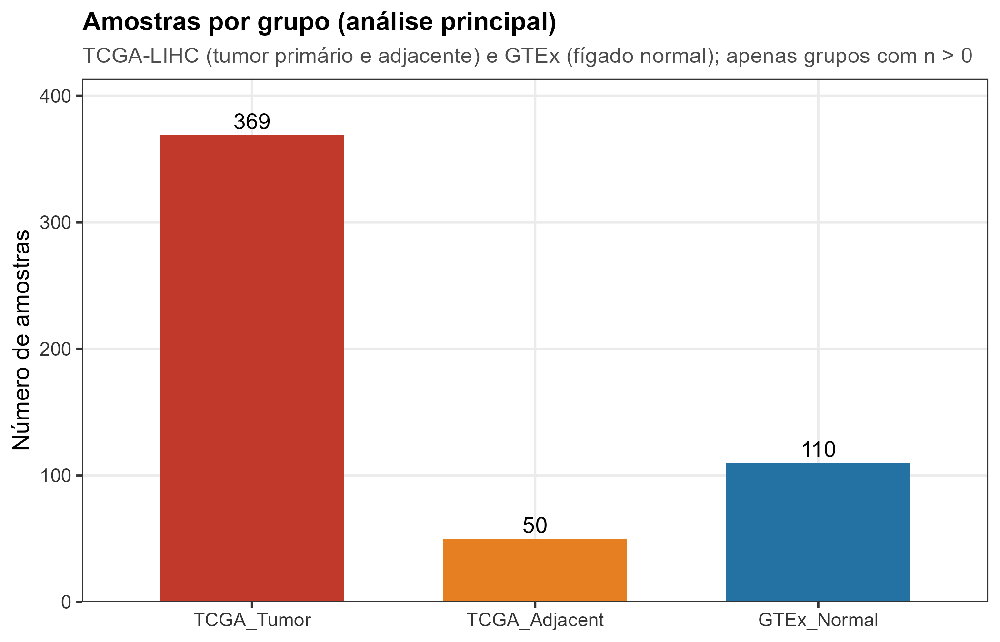

*Figura 1. Distribuição das amostras hepáticas por grupo (apenas grupos com n > 0).*

> A versão anterior cruzava estudo × condição e exibia combinações vazias
> (`GTEx × Tumor = 0`, `TCGA × Normal = 0` etc.). A figura atual conta apenas
> os grupos realmente observados; as 2 recidivas, excluídas da análise
> principal, aparecem na Figura 26 (`docs/10_grupos_alternativos.md`).

---

## 1.3 Fenótipos clínicos

### 1.3.1 Sexo

| Grupo | Feminino | Masculino | Total |
|---|---:|---:|---:|
| TCGA tumor | 120 (32,5%) | 249 (67,5%) | 369 |
| TCGA adjacente | 22 (44,0%) | 28 (56,0%) | 50 |
| GTEx normal | 33 (30,0%) | 77 (70,0%) | 110 |

Testes qui-quadrado:

| Comparação | p |
|---|---:|
| TCGA tumor vs. GTEx normal | 0,703 |
| TCGA tumor vs. TCGA adjacente | 0,147 |
| TCGA adjacente vs. GTEx normal | 0,121 |

**Interpretação:** a proporção de homens é alta em todos os grupos, mas não há
diferença estatisticamente significativa entre eles. Ainda assim, sexo foi
incluído como covariável nas análises de expressão diferencial, pois pode
explicar parte da variância (especialmente genes ligados ao cromossomo X/Y).

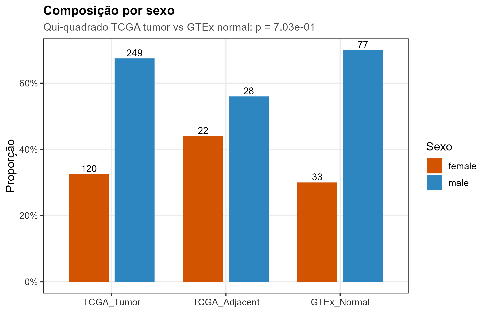

*Figura 2. Composição por sexo em cada grupo.*

### 1.3.2 Idade

| Grupo | n | Média ± DP | Mediana | Q1–Q3 | Mín–Máx |
|---|---:|---:|---:|---:|---:|
| TCGA tumor | 368 | 59,4 ± 13,5 | 61 | 51,8–69,0 | 16–90 |
| TCGA adjacente | 50 | 61,7 ± 16,1 | 68,5 | 52,3–74,5 | 20–81 |
| GTEx normal | 110 | 53,7 ± 11,1 | 55 | 45,0–65,0 | 25–65* |

\* A idade no GTEx é derivada do ponto médio da faixa etária do doador
(`20-29`, `30-39`, …, `60-69`), por isso os valores são discretizados.

Testes:

| Comparação | Teste | p |
|---|---|---:|
| TCGA tumor vs. GTEx normal | Wilcoxon | 3,96 × 10⁻⁶ |
| TCGA tumor vs. TCGA adjacente | Wilcoxon | 0,0438 |
| Três grupos | Kruskal-Wallis | 8,80 × 10⁻⁷ |

**Interpretação:** os tumores TCGA são, em média, ~5,7 anos mais velhos que os
doadores GTEx. Essa diferença é estatisticamente significativa e justifica o
ajuste por idade nas comparações TCGA × GTEx. A idade também foi usada para
comparações internas (≥65 vs. <65 no TCGA; ≥60 vs. <60 no GTEx).

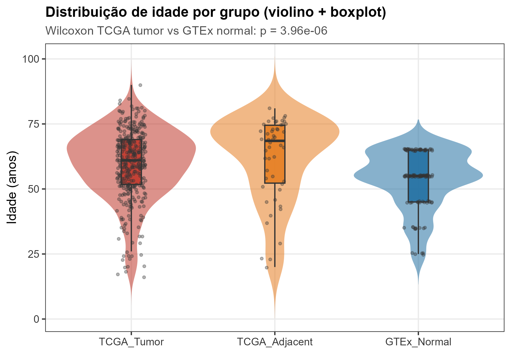

*Figura 3. Distribuição de idade por grupo (violino + boxplot).*

### 1.3.3 Estágio AJCC (TCGA tumor)

| Estágio | n | % |
|---|---:|---:|
| I | 169 | 45,8 |
| II | 86 | 23,3 |
| III | 85 | 23,0 |
| IV | 5 | 1,4 |
| Não informado | 24 | 6,5 |

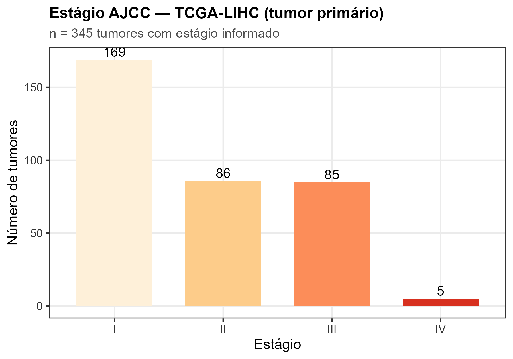

*Figura 4. Estágio AJCC dos tumores primários TCGA-LIHC.*

**Interpretação:** há predomínio de estágios iniciais (I–II = 69,1%), o que é
típico de coortes cirúrgicas. O número de tumores estágio IV é pequeno (n = 5),
limitando a comparação IV vs. I–III; por isso a análise de expressão agrupou
III–IV vs. I–II.

### 1.3.4 Grau histológico (TCGA tumor)

| Grau | n | % |
|---|---:|---:|
| G1 | 55 | 14,9 |
| G2 | 177 | 48,0 |
| G3 | 121 | 32,8 |
| G4 | 11 | 3,0 |
| Não informado | 5 | 1,4 |

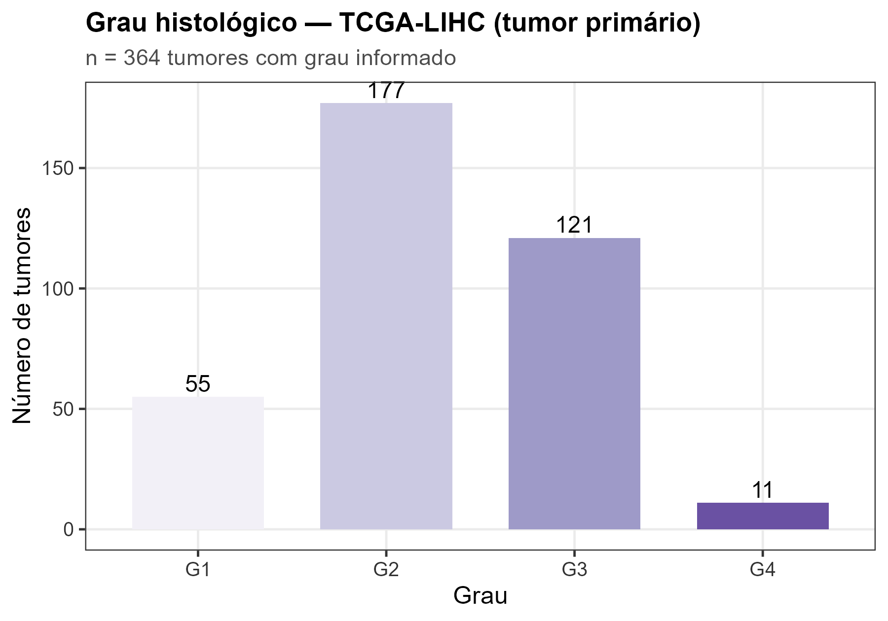

*Figura 5. Grau histológico dos tumores primários TCGA-LIHC.*

**Interpretação:** a maioria é G2–G3. Para aumentar o poder, a análise de
expressão comparou G3–G4 vs. G1–G2.

### 1.3.5 Estágio × grau

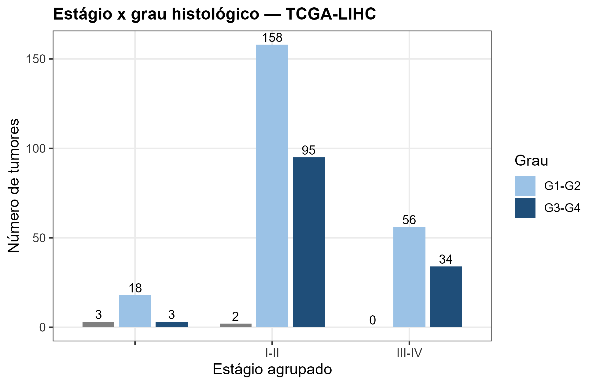

*Figura 6. Distribuição conjunta de estágio agrupado e grau agrupado.*

> A exploração ampliada de fenótipos — missingness, AFP, fibrose, sorologia
> viral, Child-Pugh, histologia, invasão vascular, Kaplan-Meier e Cox — está em
> [`docs/08_fenotipos_avancados.md`](08_fenotipos_avancados.md).

---

## 1.4 Padrões globais de expressão (UMAP)

Foi feito **UMAP** (*Uniform Manifold Approximation and Projection*) com os
**2.000 genes mais variáveis**, usando:

| Parâmetro | Valor |
|---|---|
| Genes | 2.000 mais variáveis |
| `n_neighbors` | 30 |
| `min_dist` | 0,25 |
| Métrica | cosine |
| `scale` | TRUE |
| `pca` (parâmetro interno do `uwot`) | 50 |
| Semente | 2026 |

Diferentemente de métodos lineares de redução de dimensionalidade, o UMAP **não fornece percentual de variância
explicada** e seus eixos não têm interpretação linear direta. Ele é usado
como visualização de vizinhança e estrutura local, não como coordenada
quantitativa.

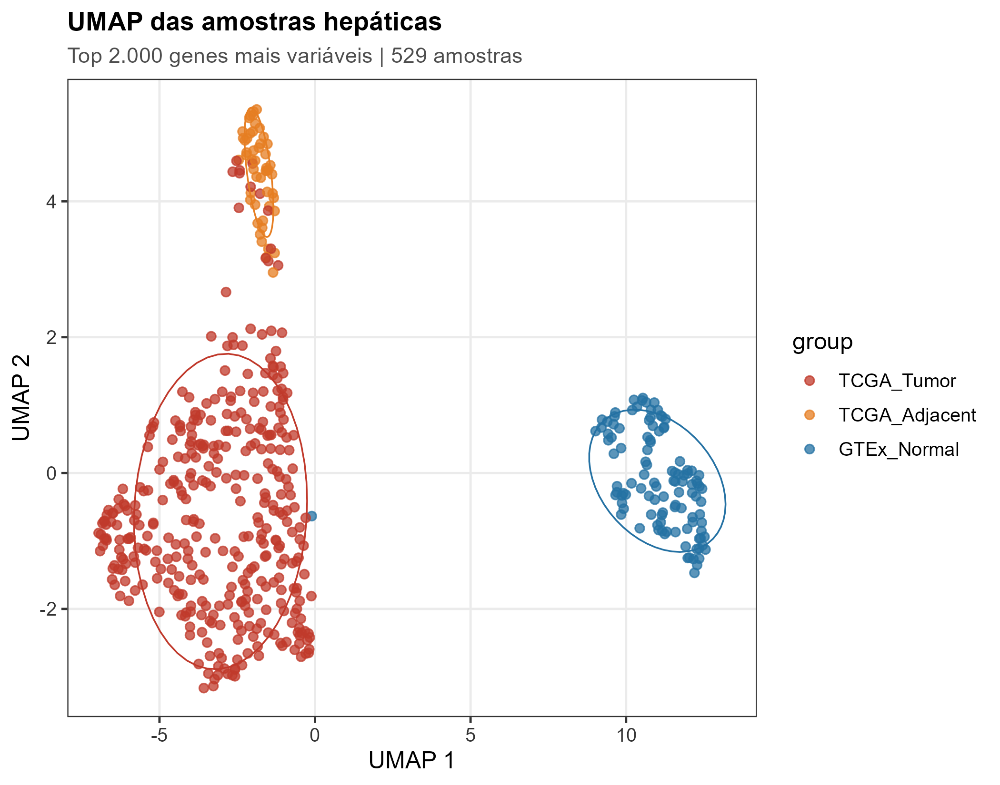

*Figura 7. UMAP colorido por grupo. TCGA tumor, TCGA adjacente e GTEx normal
separam-se parcialmente.*

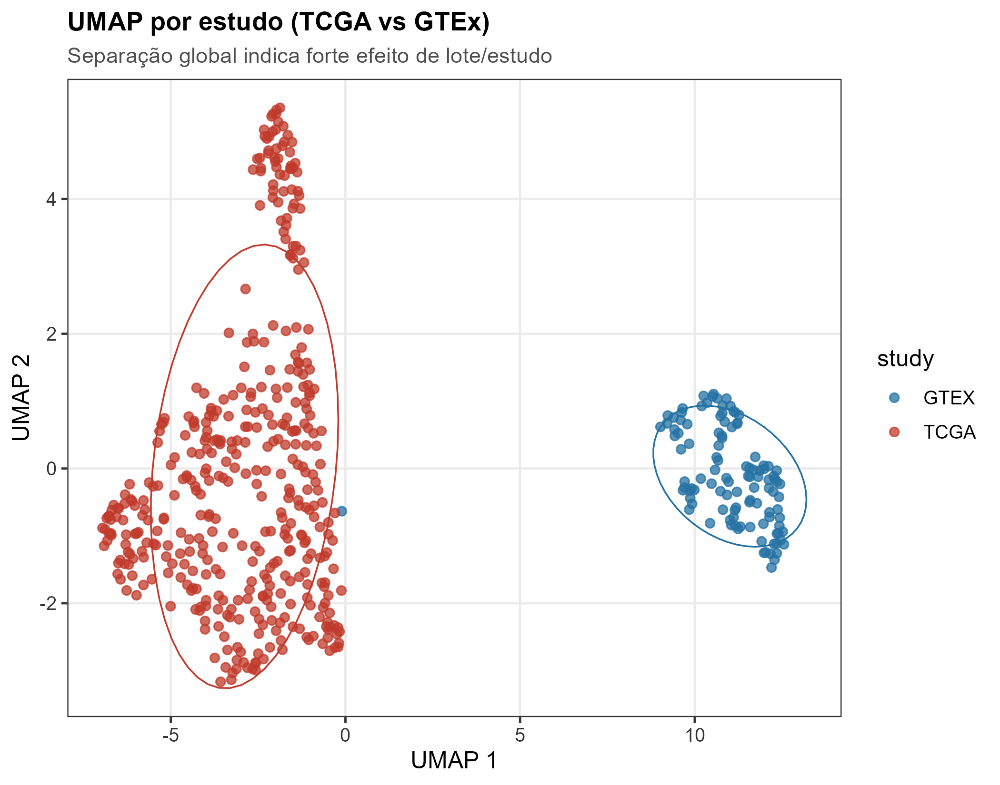

*Figura 8. UMAP colorido por estudo. A separação TCGA vs. GTEx é evidente,
indicando forte efeito de estudo/lote.*

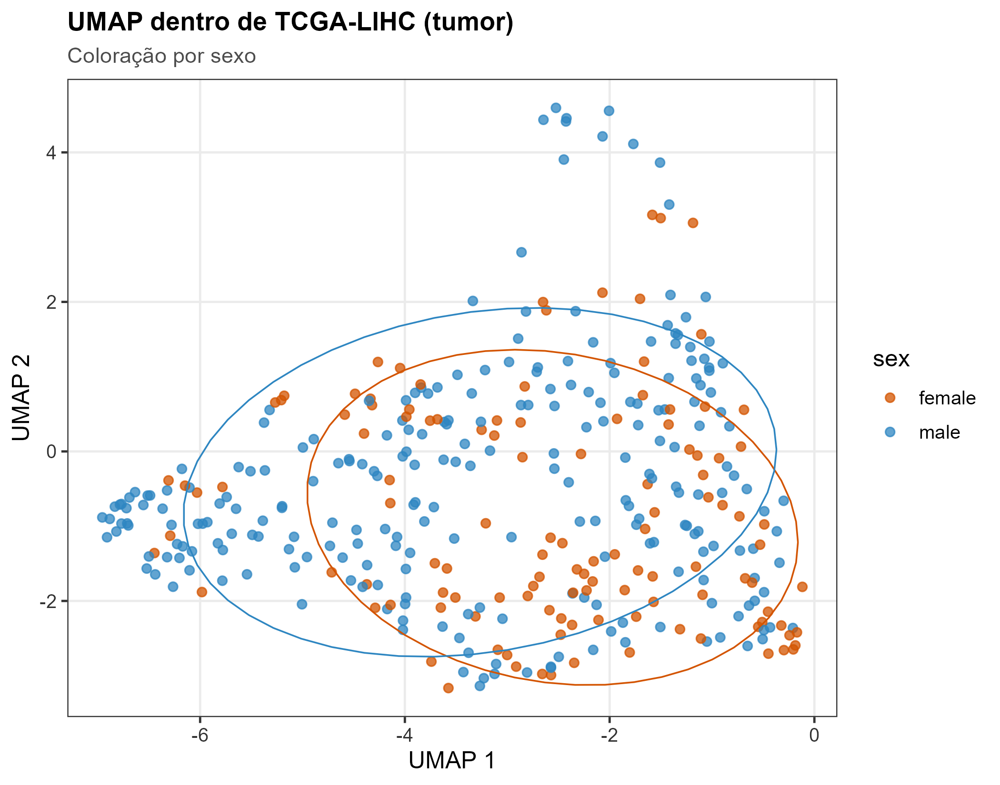

*Figura 9. UMAP dentro dos tumores TCGA, colorido por sexo.*

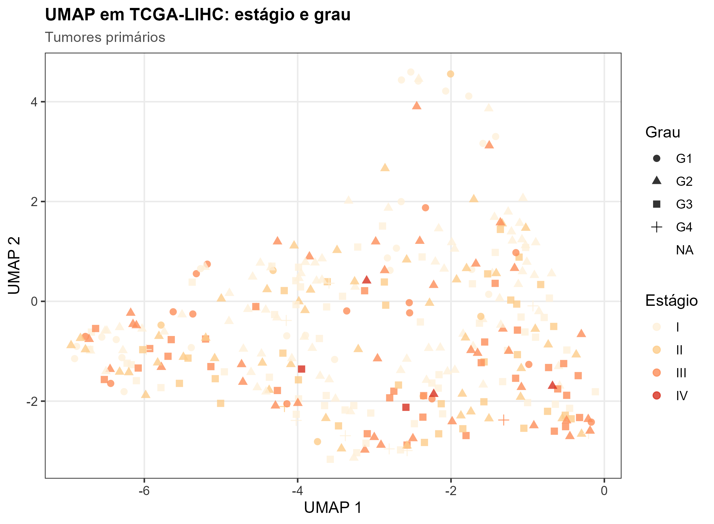

*Figura 10. UMAP dos tumores TCGA, colorido por estágio e com forma por grau.*

### Associação das coordenadas UMAP com a clínica

Correlações de Spearman dentro dos tumores TCGA (apenas exploratórias):

| Variável | UMAP1 (ρ) | p (UMAP1) | UMAP2 (ρ) | p (UMAP2) |
|---|---:|---:|---:|---:|
| Idade | −0,140 | 0,0073 | 0,207 | 6,5 × 10⁻⁵ |
| Estágio | 0,076 | 0,159 | −0,222 | 3,1 × 10⁻⁵ |
| Grau | 0,108 | 0,040 | −0,346 | 1,2 × 10⁻¹¹ |

**Interpretação:**

- **UMAP2** captura um eixo inversamente associado à **agressividade tumoral**:
  quanto maior o grau, menor a coordenada UMAP2 (ρ = −0,346); o mesmo padrão,
  mais fraco, aparece para estágio (ρ = −0,222).
- **UMAP2** também se associa positivamente com idade (ρ = 0,207), indicando
  que idade e biologia tumoral contribuem de formas parcialmente
  independentes.
- **UMAP1** tem associações fracas (idade ρ = −0,140; grau ρ = 0,108; estágio
  ρ = 0,076) e não deve ser interpretado como um eixo clínico.
- Como o UMAP é não linear, essas correlações servem apenas como pistas
  exploratórias; a inferência principal vem do `limma` e dos modelos de
  sobrevida.

---

## 1.5 Heatmap dos genes mais variáveis

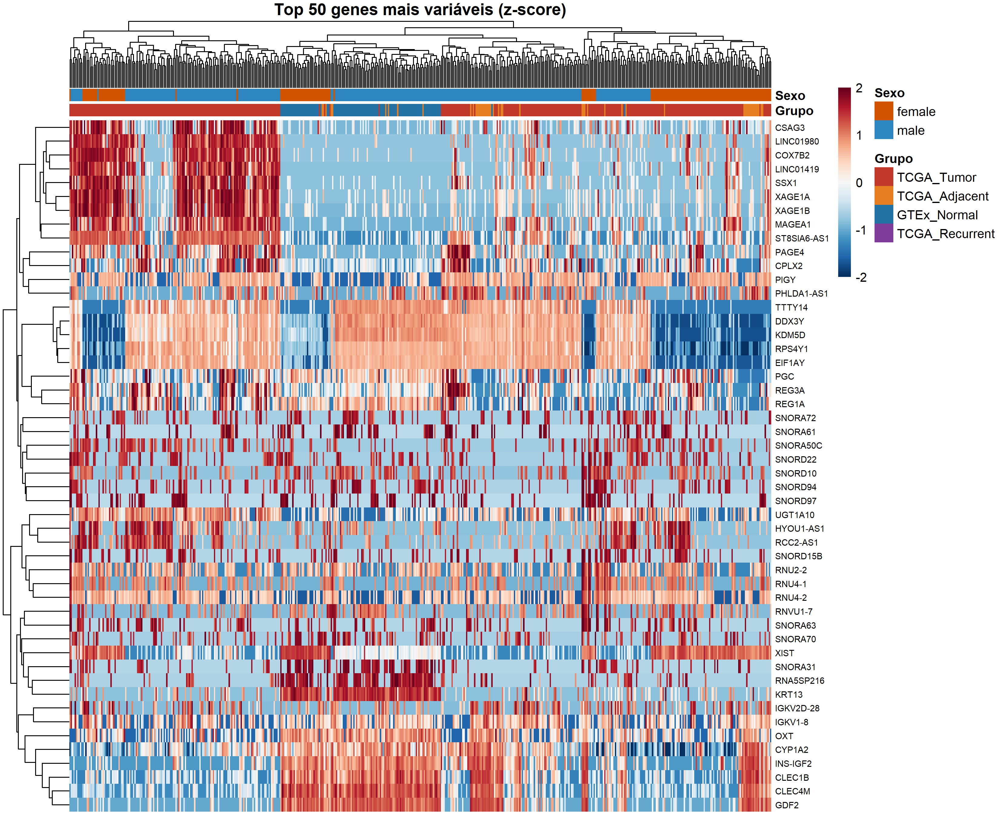

*Figura 11. Heatmap dos 50 genes mais variáveis (z-score por gene). As colunas
são amostras; as barras superiores indicam grupo e sexo.*

**Interpretação:** há blocos de genes com expressão claramente distinta entre
TCGA tumor e GTEx normal, e também heterogeneidade dentro dos tumores. A
estrutura por grupo é consistente com o UMAP e com os resultados de expressão
diferencial.

---

## 1.6 Marcadores conhecidos de HCC e remodelamento tecidual

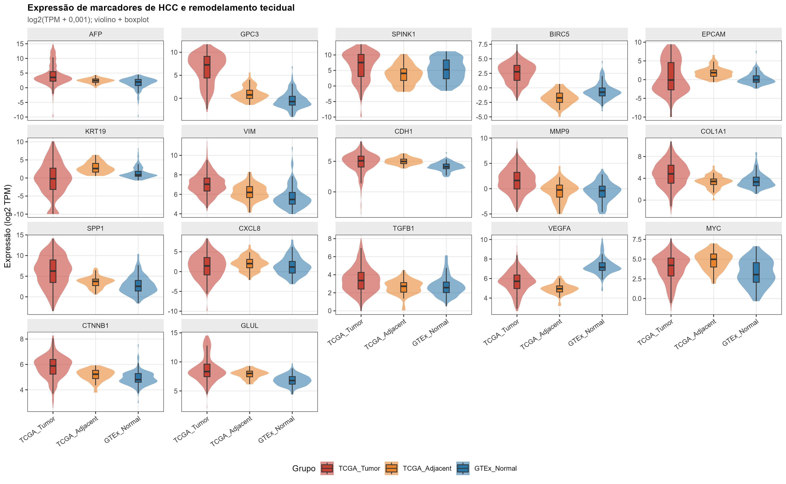

*Figura 12. Expressão de marcadores selecionados nos três grupos (violino + boxplot).*

Destaques:

- **GPC3** e **AFP**: marcadores clássicos de HCC, com expressão elevada no
  tumor.
- **BIRC5** (survivina): gene de proliferação/antiapoptose, elevado no tumor.
- **MMP9**, **COL1A1**, **VIM**, **SPP1**: associados a remodelamento da matriz
  extracelular, invasão e transição epitélio-mesenquimal.
- **CDH1** (E-caderina): tende a ser menor no tumor, consistente com perda de
  adesão epitelial.
- **KRT19** e **EPCAM**: marcadores de progenitores/ductais; a interpretação é
  mais heterogênea e depende do subtítulo molecular.

Os valores individuais estão em
`resultados/tabelas/12_expressao_marcadores.csv`.

---

## 1.7 Síntese da análise exploratória

1. **A coorte é predominantemente masculina** (≈67% no TCGA tumor e ≈70% no
   GTEx), sem diferença significativa entre os grupos.
2. **A idade difere entre TCGA e GTEx** (p = 3,96 × 10⁻⁶), o que motivou o
   ajuste por idade nas comparações entre estudos.
3. **A maioria dos tumores é estágio I–II e grau G2–G3**; os subgrupos extremos
   (estágio IV, grau G4) são pequenos.
4. **UMAP2 resume um eixo de agressividade** (grau > estágio > idade) e mostra
   que a expressão global carrega informação clínica relevante.
5. **Há separação global entre TCGA e GTEx** (UMAP), compatível com efeito de
   estudo/lote e com diferenças de composição tecidual.
6. **Marcadores clássicos de HCC** (GPC3, AFP, BIRC5) e de remodelamento
   (MMP9, COL1A1, VIM, SPP1) apresentam o comportamento esperado, validando o
   processamento e a anotação.

---

## 1.8 Limitações desta etapa

- A idade do GTEx é uma **faixa** convertida para o ponto médio; isso introduz
  erro de medida e reduz a precisão das comparações etárias.
- O estágio e o grau são **do paciente**, não necessariamente da amostra
  específica; no TCGA, os 50 tecidos adjacentes herdam o estágio/grau do tumor
  do mesmo paciente. Por isso as análises de estágio/grau usam apenas tumores.
- O UMAP é sensível à seleção de genes (top 2.000 por variância), aos
  hiperparâmetros (`n_neighbors`, `min_dist`) e ao efeito de lote. A separação
  por estudo não deve ser interpretada como prova de diferença biológica.
- O UMAP não fornece variância explicada e seus eixos não são lineares; por
  isso, as correlações com clínica são apenas exploratórias.
- A análise exploratória é **descritiva**; os testes de hipótese principais
  estão na etapa de expressão diferencial (`docs/04_volcano_plots.md`).
