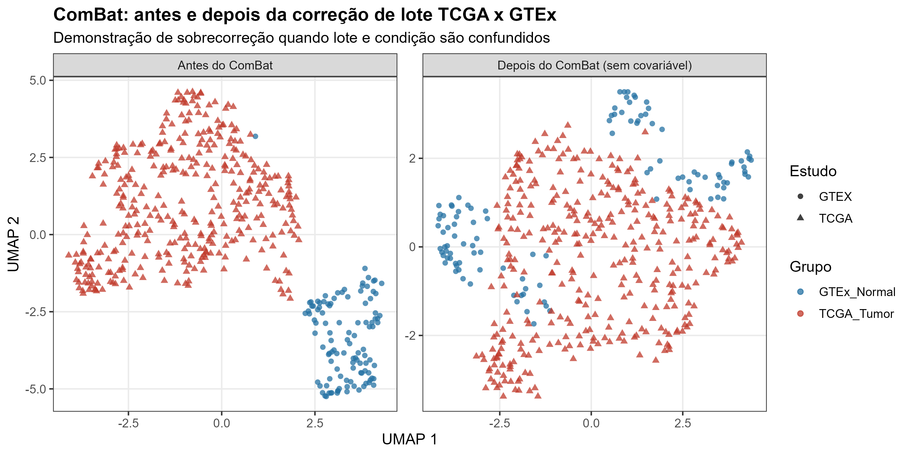
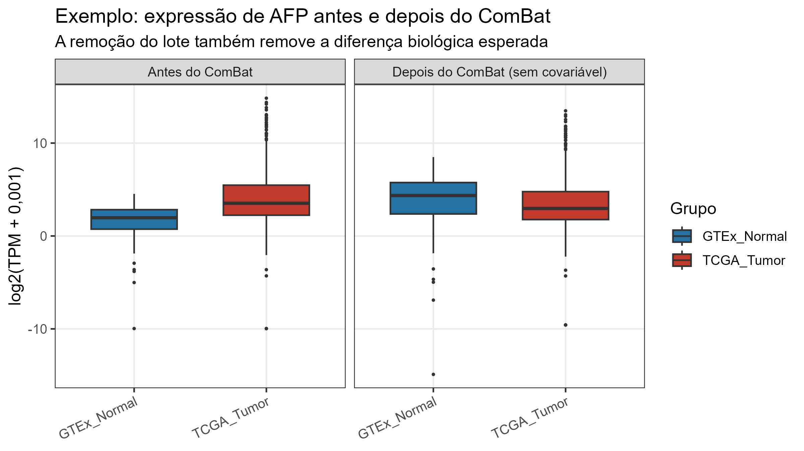

# 2. ComBat (`sva`): o que é, como funciona e limites na deconvolução celular

> Documento de apoio ao seminário. Arquivo: `docs/02_ComBat.md`.
> Demonstração executável: `scripts/04_ComBat_demonstracao.R`.
> Resultados: `resultados/tabelas/DE/COMPARACAO_ComBat_antes_depois.csv`,
> `resultados/qc/resumo_ComBat_demonstracao.txt`.

---

## 2.1 O que é o ComBat?

O **ComBat** é uma função do pacote Bioconductor **`sva`** (*Surrogate Variable
Analysis*) voltada à **correção de efeitos de lote** (*batch effects*) em dados
de expressão gênica de alta dimensão. O nome vem de *Combating Batch Effects*
(“combatendo efeitos de lote”).

Um **efeito de lote** é uma fonte de variação técnica ou de amostragem que não
interessa biologicamente, mas que altera a expressão medida. Exemplos:

- amostras processadas em dias, placas, centros ou sequenciadores diferentes;
- coortes distintas (por exemplo, TCGA e GTEx);
- diferentes protocolos de extração de RNA, bibliotecas ou pipelines;
- diferentes technologias (microarray vs. RNA-seq, RNA-seq bulk vs. single-cell).

Se não for tratado, o lote pode:

1. criar agrupamentos artificiais em análises de redução de dimensionalidade (ex.: UMAP);
2. inflar ou reduzir taxas de falsos positivos na expressão diferencial;
3. fazer com que a variável de interesse fique confundida com a variável
   técnica, tornando a interpretação inválida.

O ComBat tenta remover o efeito de lote **preservando** as diferenças
biológicas que forem explicitamente informadas no modelo.

---

## 2.2 Modelo estatístico

Para cada gene $g$ e cada amostra $i$, o ComBat assume um modelo aditivo e
multiplicativo:

$$
y_{gi} = \alpha_g + X_i\beta_g + \gamma_{g,b(i)} + \delta_{g,b(i)}\,\varepsilon_{gi}
$$

em que:

| Termo | Interpretação |
|---|---|
| $y_{gi}$ | expressão do gene $g$ na amostra $i$ (em escala logarítmica) |
| $\alpha_g$ | expressão média global do gene $g$ |
| $X_i$ | vetor de covariáveis biológicas da amostra $i$ (ex.: grupo tumoral, sexo, idade) |
| $\beta_g$ | efeitos das covariáveis biológicas no gene $g$ |
| $b(i)$ | lote ao qual a amostra $i$ pertence |
| $\gamma_{g,b(i)}$ | efeito **aditivo** (deslocamento da média) do lote $b$ no gene $g$ |
| $\delta_{g,b(i)}$ | efeito **multiplicativo** (escala/dispersão) do lote $b$ no gene $g$ |
| $\varepsilon_{gi}$ | erro residual, em geral assumido normal com média zero |

O ComBat estima, para cada gene e cada lote, os parâmetros de **locação**
($\gamma$) e **escala** ($\delta$). Em seguida, os valores são ajustados para
voltar à escala comum:

$$
y^{*}_{gi} = \frac{y_{gi} - \hat{\alpha}_g - X_i\hat{\beta}_g - \hat{\gamma}_{g,b(i)}}{\hat{\delta}_{g,b(i)}} + \hat{\alpha}_g + X_i\hat{\beta}_g
$$

Na prática, o ComBat implementa uma versão **empírico-bayesiana**: os
parâmetros de cada gene não são estimados de forma totalmente independente.
Assume-se uma distribuição *a priori* comum para os efeitos de lote e a
estimativa de cada gene é “encolhida” (*shrinkage*) em direção a essa
distribuição. Isso estabiliza as estimativas, sobretudo quando o número de
amostras por lote é pequeno.

### 2.2.1 Principais argumentos da função

```r
sva::ComBat(
  dat       = matriz_log2,       # genes x amostras
  batch     = vetor_de_lote,     # fator com o lote de cada amostra
  mod       = model.matrix(~ grupo + sexo + idade, data = metadados),
  par.prior = TRUE,              # estimação paramétrica empírico-bayesiana
  mean.only = FALSE,             # TRUE = corrige apenas a média (locação)
  ref.batch = NULL               # opcional: escolhe um lote de referência
)
```

- **`dat`**: matriz numérica em escala logarítmica (log2 de TPM, logCPM,
  intensidades normalizadas etc.). O ComBat **não** foi desenhado para
  contagens brutas.
- **`batch`**: fator ou vetor que identifica o lote.
- **`mod`**: matriz de desenho com as variáveis biológicas que devem ser
  **preservadas**. É o argumento mais importante para a validade da análise.
- **`par.prior = TRUE`**: usa prioris paramétricas (mais comum e mais rápido).
  Com `FALSE`, usa estimação não paramétrica.
- **`mean.only = TRUE`**: corrige somente o deslocamento médio, sem mexer na
  variância. Útil quando se quer uma correção mais conservadora.
- **`ref.batch`**: define um lote de referência; os demais são ajustados a ele.
  Útil quando um lote é claramente o “padrão-ouro”.

Existe também o **`ComBat-seq`** (pacote `sva`), apropriado para **contagens
brutas** de RNA-seq, que modela os dados com distribuição binomial negativa.
Para TPM/log2 TPM, o ComBat clássico é o mais usado.

---

## 2.3 O que o ComBat **não** faz

É fundamental entender as limitações:

1. **Não resolve confundimento estrutural.** Se todos os tumores vêm do TCGA e
   todos os normais vêm do GTEx, então “estudo” e “condição tumor/normal” são
   perfeitamente confundidos. O ComBat não consegue separar o efeito de lote do
   efeito biológico, porque não há informação suficiente para isso.
2. **Não substitui um bom desenho experimental.** Nenhum método estatístico
   recupera a biologia perdida por um desenho totalmente confundido.
3. **Pode remover sinal biológico** se a composição celular ou a condição
   biológica não estiverem representadas em `mod`.
4. **Não é indicado para contagens brutas.** Use `ComBat-seq` ou métodos
   específicos para contagens.
5. **Pode distorcer genes com efeito de lote não linear** ou genes com
   expressão muito baixa/zero.
6. **É sensível ao número de amostras por lote.** Lotes muito pequenos geram
   estimativas instáveis, mesmo com *shrinkage*.

---

## 2.4 Demonstração com os dados TCGA-LIHC × GTEx

A demonstração está em `scripts/04_ComBat_demonstracao.R`. Foram usadas 478
amostras (368 tumores TCGA e 110 fígados normais GTEx) e 12.401 genes.

### Cenário 1 — tentativa de preservar a condição

Foi solicitado:

```r
mod <- model.matrix(~ group_tg, data = meta_cb)  # group_tg = tumor/normal
ComBat(dat = X, batch = study, mod = mod)
```

Resultado:

```text
Error: The covariate is confounded with batch! Remove the covariate and rerun ComBat
```

Ou seja, o próprio ComBat detecta que a condição biológica (tumor vs. normal)
é **perfeitamente confundida** com o lote (TCGA vs. GTEx). Nesse cenário, não
existe informação suficiente para estimar simultaneamente o efeito de lote e o
efeito biológico.

### Cenário 2 — ComBat sem covariável biológica

Para fins didáticos, rodamos o ComBat **sem** informar a condição:

```r
X_cor <- ComBat(dat = X, batch = study, mod = NULL)
```

O lote é removido, mas como a condição é indistinguível do lote, a diferença
tumor-normal também é removida. Resultados:

| Métrica | Antes do ComBat | Depois do ComBat (sem covariável) |
|---|---:|---:|
| DEGs (FDR < 0,05 e \|logFC\| > 1) | 3.388 | **1** |
| Up-regulados | 2.245 | 1 |
| Down-regulados | 1.143 | 0 |
| DEGs em comum | — | 1 |
| Jaccard dos DEGs | — | 0,000 |
| Correlação de logFC (Spearman) | — | 0,647 |

**Interpretação:** o ComBat “funcionou” tecnicamente — removeu o lote —, mas
removeu também a biologia. O resultado (1 DEG) é um exemplo de
**sobrecorreção** (*overcorrection*). Isso ilustra por que não aplicamos ComBat
cegamente à comparação TCGA × GTEx.



*Figura 13. UMAP com os 2.000 genes mais variáveis antes e depois do ComBat sem
covariável. A separação entre TCGA e GTEx desaparece, mas a diferença
tumor-normal também.*



*Figura 14. Exemplo com AFP: a expressão média cai e a diferença biológica
esperada entre tumor e fígado normal é atenuada após a correção sem
covariável.*

### O que fazemos na análise principal

Na análise principal (`scripts/02_expressao_diferencial.R`), **não aplicamos
ComBat** à comparação TCGA tumor × GTEx normal. Em vez disso:

- usamos `limma` com **sexo e idade como covariáveis**;
- tratamos a comparação **TCGA tumor × TCGA adjacente** como a comparação
  interna mais limpa para identificar genes associados à transformação
  maligna;
- usamos **TCGA adjacente × GTEx normal** para estimar o quanto os tecidos
  “normais” diferem entre os dois estudos (uma medida do efeito de lote e de
  diferenças de composição tecidual);
- interpretamos a comparação TCGA × GTEx com cautela, sabendo que o efeito
  estimado combina biologia tumoral + diferenças de estudo/tecido.

---

## 2.5 Aplicação e limitação do ComBat na deconvolução celular

### 2.5.1 O problema da deconvolução

Dados de expressão **bulk** (como TCGA e GTEx) medem a média de milhares de
células. A **deconvolução celular** tenta estimar a proporção de cada tipo
celular (hepatócitos, células imunes, fibroblastos, células endoteliais etc.)
a partir dessa mistura, usando assinaturas de referência (scRNA-seq ou sorted
cells). Exemplos de métodos: CIBERSORTx, MuSiC, BayesPrism, cell2location,
Tangram, entre outros.

O problema é que a deconvolução é extremamente sensível a:

- diferenças de plataforma entre a referência e o alvo (microarray vs. RNA-seq,
  bulk vs. single-cell);
- diferenças de protocolo e de estudo;
- genes marcadores de tipo celular que também são afetados por lote;
- composição celular diferente entre lotes.

### 2.5.2 Onde o ComBat pode ajudar

O ComBat pode ser aplicado **antes** da deconvolução para harmonizar:

- matrizes de referência construídas em estudos diferentes;
- amostras bulk de coortes diferentes;
- pseudobulk de scRNA-seq de diferentes doadores/batches.

Se a composição celular for conhecida ou puder ser aproximada, ela pode ser
incluída em `mod` para que o ComBat **preserve** as diferenças de composição.
Também é possível corrigir apenas a média (`mean.only = TRUE`) para reduzir o
risco de distorcer a variabilidade biológica.

### 2.5.3 Por que o ComBat pode ser perigoso na deconvolução

O ComBat assume que o efeito de lote é **independente** da biologia. Na
deconvolução, essa premissa frequentemente falha:

1. **A composição celular varia com o lote.** Por exemplo, amostras processadas
   em um centro podem ter mais infiltrado imune; se isso não estiver em `mod`,
   o ComBat pode remover justamente o sinal de composição que se quer estimar.
2. **Assinaturas de tipos celulares podem ser confundidas com lote.** Genes
   marcadores de hepatócitos, células T, macrófagos etc. podem ter efeitos de
   lote específicos. Corrigi-los pode apagar a assinatura que a deconvolução
   precisa.
3. **Lote e condição podem ser confundidos.** Como no exemplo TCGA × GTEx, se
   todos os tumores vêm de um estudo e todos os normais de outro, o ComBat não
   consegue separar lote de doença.
4. **Correção em escala logarítmica não é neutra.** A transformação
   aditiva/multiplicativa pode alterar a relação entre genes e a composição
   celular, sobretudo para genes de baixa expressão.
5. **Referência e alvo podem ter distribuições diferentes.** O ComBat pode
   aproximar as distribuições, mas não garante que a relação linear assumida
   pela deconvolução seja preservada.

### 2.5.4 Recomendações práticas

- **Inclua a composição celular em `mod`** quando ela for conhecida ou puder ser
  estimada (por exemplo, com um método robusto inicial).
- **Faça a correção por lote dentro de cada condição biológica**, quando
  possível, em vez de misturar condições confundidas.
- **Use `mean.only = TRUE`** se o objetivo for apenas alinhar médias e preservar
  a variabilidade.
- **Valide com marcadores conhecidos** (ex.: AFP, GPC3, ALB, immune markers)
  antes e depois da correção.
- **Compare resultados com e sem ComBat** e reporte a sensibilidade.
- **Para scRNA-seq**, prefira métodos específicos de integração (Harmony,
  scVI, BBKNN, Seurat integration) em vez de ComBat gene a gene.
- **Para contagens**, use `ComBat-seq` ou modelos binomial negativo.
- **Evite ComBat quando lote e condição são perfeitamente confundidos.** Nesse
  caso, a conclusão honesta é que o efeito não é identificável; a solução é
  obter amostras adicionais ou usar comparações internas (ex.: tumor vs.
  adjacente dentro do TCGA).

---

## 2.6 Resumo em uma frase

O ComBat é uma ferramenta poderosa para remover efeitos técnicos quando o lote
é **separável** da biologia e quando as covariáveis biológicas são informadas;
na deconvolução celular, ele só deve ser usado com cautela, pois a composição
celular é simultaneamente biologia e possível fonte de lote — e corrigir o
lote sem preservar a composição pode apagar exatamente o sinal que se deseja
medir.
