# 4. Volcano plots: construção e interpretação

> Arquivo: `docs/04_volcano_plots.md`.
> Script: `scripts/03_volcano_plots.R`.
> Figuras: `resultados/figuras/Volcano_*.png` (somente PNG).
> Tabelas: `resultados/tabelas/DE/` e `resultados/tabelas/ROTULOS_Volcano_*.csv`.

---

## 4.1 O que é um volcano plot?

O **volcano plot** combina duas informações de cada gene:

- **Eixo x:** `logFC` — magnitude e direção da diferença de expressão.
- **Eixo y:** `−log10(FDR)` — significância estatística ajustada para
  múltiplos testes. Quanto mais alto, menor o FDR.

Cada ponto é um gene. A forma de “vulcão” aparece porque genes com `logFC`
grande tendem a ter p-valores pequenos, mas genes com `logFC` pequeno podem ser
muito significativos se a variância for baixa.

### Regiões do gráfico

| Região | Interpretação |
|---|---|
| Direita superior | up-regulado e significativo |
| Esquerda superior | down-regulado e significativo |
| Centro (baixo) | sem evidência de diferença |
| Laterais inferiores | `logFC` grande, mas não significativo (alta variância/poucas amostras) |

### Critérios usados

- **FDR < 0,05** (Benjamini-Hochberg).
- **|logFC| > 1** (equivalente a fold change > 2 ou < 0,5).
- Cores:
  - vermelho = up-regulado;
  - azul = down-regulado;
  - cinza = não significativo.
- Linhas tracejadas: FDR = 0,05 e logFC = ±1.

> O critério |logFC| > 1 é uma escolha pragmática para priorizar efeitos
> biologicamente relevantes. Ele não é obrigatório; genes com |logFC| < 1
> podem ser significativos e devem ser consultados nas tabelas completas.

---

## 4.2 Os três volcano plots principais

### 4.2.1 LIHC (TCGA): tumor primário vs. tecido adjacente

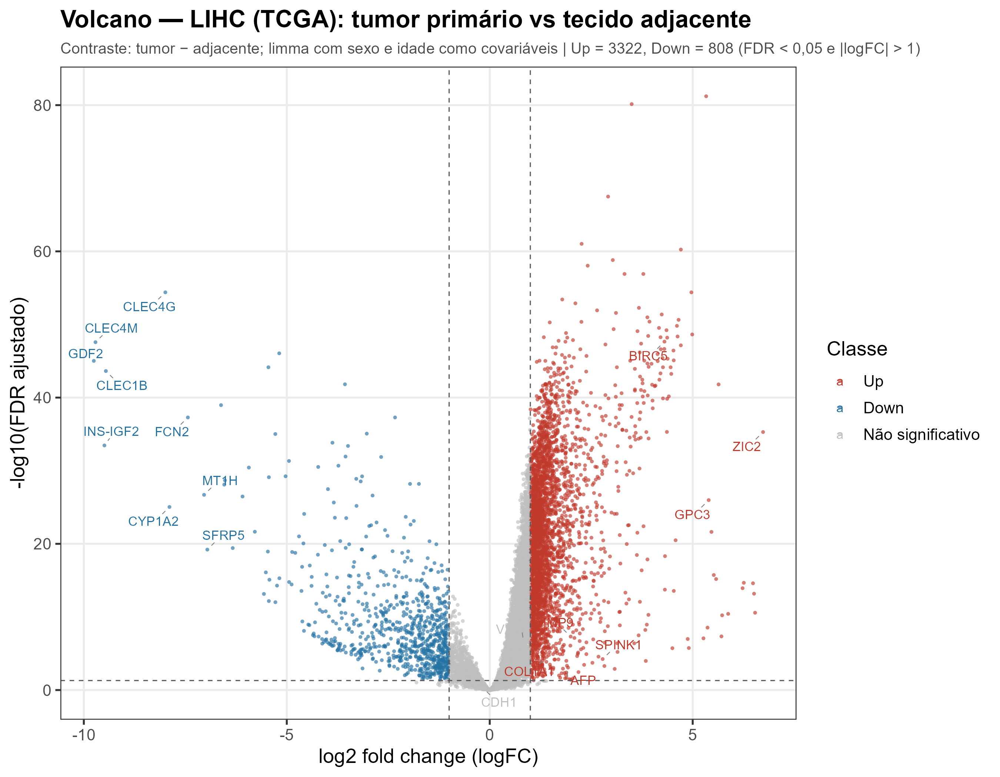

*Figura V1. Volcano plot da comparação interna no TCGA: 369 tumores primários
vs. 50 tecidos adjacentes. Modelo `limma` com sexo e idade como covariáveis.*

**Resultado:** **3.322 genes up** e **808 genes down** no tumor
(FDR < 0,05 e |logFC| > 1).

**Genes up de destaque:** GABRD, PLVAP, DIPK2B, TOMM40L, HIGD1B, SLC26A6,
MSTO1, UBE2T, MXD3, CDC25C, BIRC5, GPC3, MMP9.

**Genes down de destaque:** CLEC4G, CLEC4M, FCN3, GDF2, CRHBP, CLEC1B, CFP,
MARCO, FCN2, ADAMTS13, CYP1A2, MT1H, SFRP5.

**Interpretação biológica:**

- **Perda de identidade hepática:** CLEC4G, CLEC4M, CLEC1B, FCN2, FCN3, GDF2,
  CRHBP, CYP1A2 e MARCO são genes de hepatócitos, células endoteliais
  sinusoidais ou células de Kupffer. A queda desses genes é consistente com
  desdiferenciação, perda de arquitetura lobular e alteração do
  microambiente imune.
- **Proliferação e ciclo celular:** UBE2T, CDC25C, BIRC5 (survivina), MXD3 e
  PLVAP indicam aumento de proliferação e remodelamento vascular.
- **Marcadores de HCC:** GPC3 e MMP9 sobem no tumor, validando a comparação.
- **GDF2 (BMP9):** reduzido no tumor; é um fator produzido por células
  estreladas hepáticas e endotélio, com papel na homeostase vascular.
- **SFRP5:** inibidor de Wnt, reduzido no tumor, compatível com ativação da via
  Wnt no HCC.

**Por que essa é a comparação interna mais valiosa?** Tumor e adjacente vêm do
mesmo estudo (TCGA), do mesmo paciente em 50 casos, e foram processados no
mesmo pipeline. Isso reduz o confundimento de lote, embora o adjacente possa
já apresentar alterações de campo de cancerização.

### 4.2.2 GTEx: masculino vs. feminino

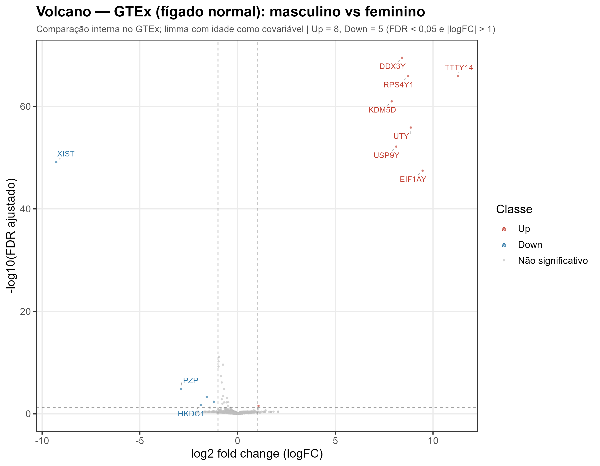

*Figura V2. Volcano plot da comparação interna no GTEx (110 fígados normais):
77 homens vs. 33 mulheres. Modelo `limma` com idade como covariável.*

**Resultado:** **8 genes up** e **5 genes down** no sexo masculino
(FDR < 0,05 e |logFC| > 1).

**Genes up em homens:** DDX3Y, TTTY14, RPS4Y1, KDM5D, UTY, USP9Y, EIF1AY,
TSPAN8.

**Genes down em homens:** XIST, PZP, VIL1.

**Interpretação:**

- Os genes up são quase todos do **cromossomo Y** (DDX3Y, RPS4Y1, KDM5D, UTY,
  USP9Y, EIF1AY, TTTY14). Isso é um **controle positivo** de sexo: o pipeline
  recupera corretamente a diferença cromossômica.
- **XIST** é o gene da inativação do cromossomo X, expresso em mulheres e
  silenciado em homens; seu `logFC` negativo em homens é o esperado.
- O número pequeno de DEGs autossômicos reflete o poder limitado (n = 110) e o
  critério rigoroso. Genes como PZP e VIL1 podem ter relevância hepática, mas
  precisam de validação.
- **Por que essa comparação?** GTEx vs. GTEx não tem tumor vs. normal; a
  comparação interna mais informativa é por sexo (e por idade). Ela serve como
  controle de qualidade e mostra que o pipeline detecta sinal biológico real
  quando ele existe.

### 4.2.3 TCGA vs. GTEx: tumor vs. fígado normal

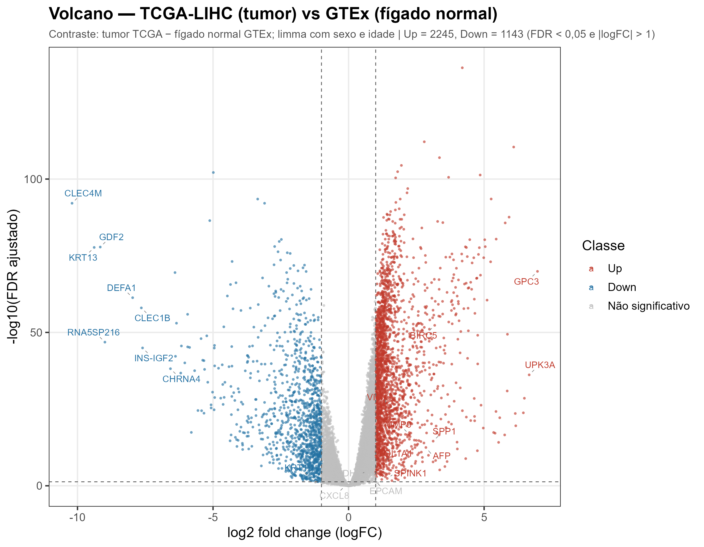

*Figura V3. Volcano plot da comparação entre estudos: 369 tumores TCGA vs.
110 fígados normais GTEx. Modelo `limma` com sexo e idade como covariáveis.*

**Resultado:** **2.245 genes up** e **1.143 genes down** no tumor
(FDR < 0,05 e |logFC| > 1).

**Genes up de destaque:** PLVAP, GBA1, RPL17P36, CD34, SEM1, PRPF6, GABRD,
LMNA, MDK, GPC3, BIRC5, VIM, MMP9, SPP1.

**Genes down de destaque:** PRSS53, CHRD, CLEC4M, ADAMTS13, RIPOR3, DNHD1,
NPIPB12, NPIPB5, GDF2, KRT13, CLEC1B, INS-IGF2, CYP1A2.

**Interpretação biológica:**

- **Ganho de proliferação, angiogênese e matriz:** PLVAP (endotélio
  fenestrado), CD34 (progenitores/endotélio), MDK (midquina), BIRC5, VIM,
  MMP9, SPP1.
- **Perda de identidade hepática:** CLEC4M, CLEC1B, GDF2, CYP1A2, CHRD,
  ADAMTS13.
- **GPC3 e AFP** sobem no tumor, reforçando a consistência com a literatura.
- **KRT13** e **INS-IGF2** aparecem com `logFC` muito negativo/positivo; alguns
  desses genes podem refletir diferenças de composição tecidual ou de
  processamento entre TCGA e GTEx.

**Cuidado crucial:** essa comparação é **confundida com o estudo**. Todo tumor
é TCGA; todo normal é GTEx. Portanto, o `logFC` estimado combina:

1. efeito biológico tumor vs. normal;
2. efeito de lote TCGA vs. GTEx;
3. diferenças de composição celular (tumor desmoplásico vs. fígado normal);
4. diferenças de seleção de doadores (idade, comorbidades, etc.).

A comparação **TCGA adjacente vs. GTEx normal** ajuda a estimar o componente
não tumoral: foram **584 up e 1.966 down** (20,6% dos genes), mostrando que os
“normais” dos dois estudos já diferem substancialmente. Isso não invalida a
comparação tumor vs. normal, mas exige moderação na interpretação dos efeitos
absolutos.

---

## 4.3 Volcano plots complementares

### Estágio III–IV vs. I–II (TCGA tumor)

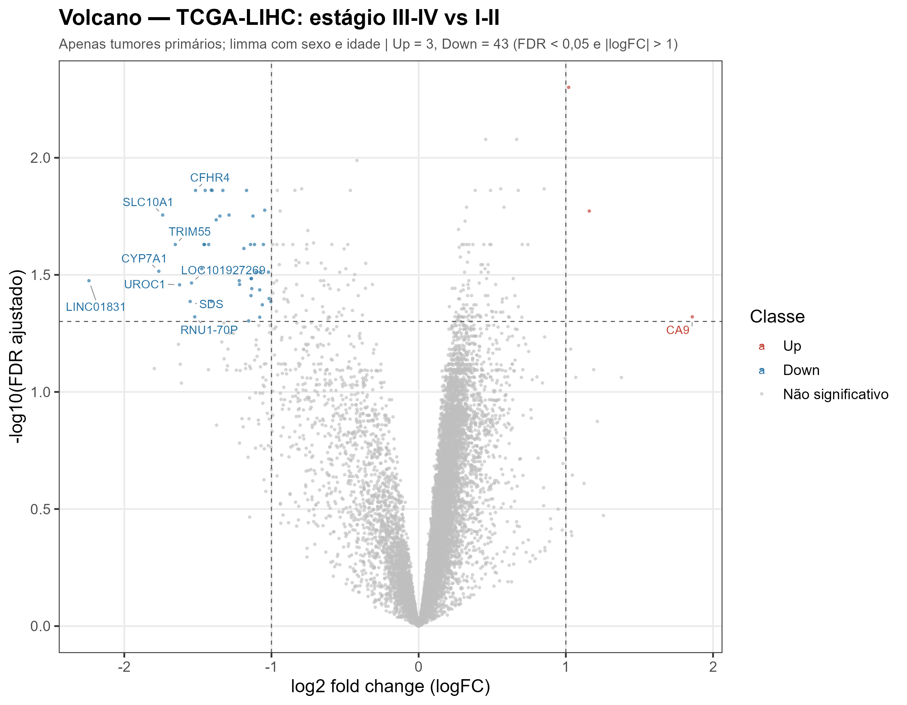

**Resultado:** 3 up e 43 down (FDR < 0,05 e |logFC| > 1).

- **Up em III–IV:** MIR210HG, SLC6A8, CA9 (hipóxia).
- **Down em III–IV:** GNMT, CFHR4, CYP2C9, CFHR1, ACOT12, FTCD, HPX, SLC10A1.

**Interpretação:** tumores mais avançados perdem genes de metabolismo
hepático/diferenciação (GNMT, CYP2C9, ACOT12, FTCD, HPX, SLC10A1) e ganham
genes de hipóxia (CA9, MIR210HG). O número pequeno de DEGs reflete o tamanho
amostral e a heterogeneidade; ainda assim, o padrão é biologicamente coerente.

### Grau G3–G4 vs. G1–G2 (TCGA tumor)

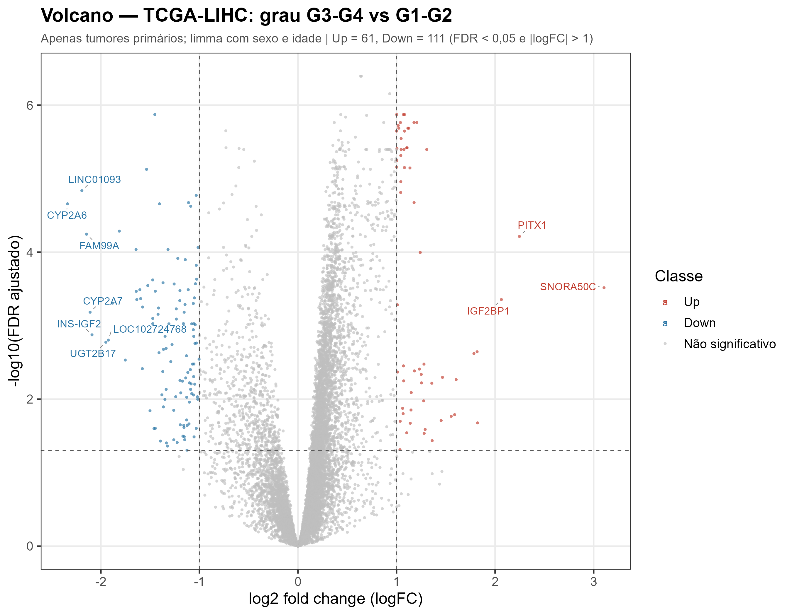

**Resultado:** 61 up e 111 down (FDR < 0,05 e |logFC| > 1).

- **Up em G3–G4:** HJURP, PTTG1, CCNB1, CDC20, TROAP, SKA3, AURKB, NUF2,
  KIF2C, CDKN3, KIFC1.
- **Down em G3–G4:** C6, CYP4F2, LINC01093, GHR, CCL14, CYP2A6, ESR1, GPD1,
  SLC10A1.

**Interpretação:** tumores de alto grau têm forte assinatura de **ciclo
celular/mitose** (AURKB, CCNB1, CDC20, NUF2, KIF2C) e perda de genes de
metabolismo/diferenciação. É um dos achados mais consistentes do ponto de vista
biológico.

### Sexo no TCGA (masculino vs. feminino)

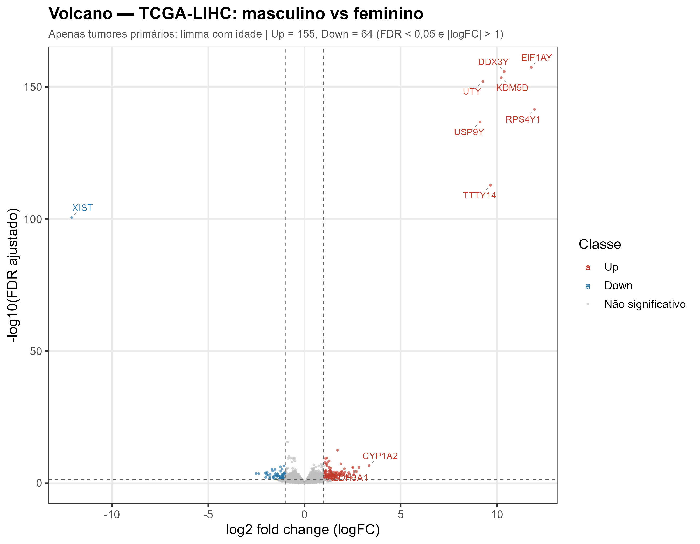

**Resultado:** 155 up e 64 down.

- Up em homens: genes do cromossomo Y (EIF1AY, DDX3Y, KDM5D, UTY, RPS4Y1,
  USP9Y, TTTY14).
- Down em homens: XIST e genes ligados ao X.

Esse resultado é um controle positivo e mostra que a comparação de sexo
funciona mesmo dentro do tumor.

### Idade no TCGA (≥65 vs. <65)

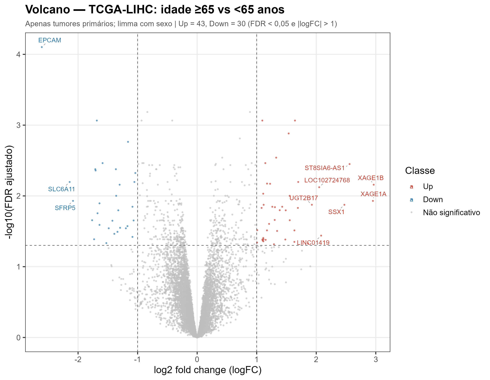

**Resultado:** 43 up e 30 down. Efeito modesto; genes como LRRC37A7P, MFAP3L,
CES5A, SLC28A1, ALDH1L1 aparecem entre os mais significativos. A interpretação
é limitada pela natureza observacional e pela correlação entre idade e outras
variáveis clínicas.

### Idade no GTEx (≥60 vs. <60)

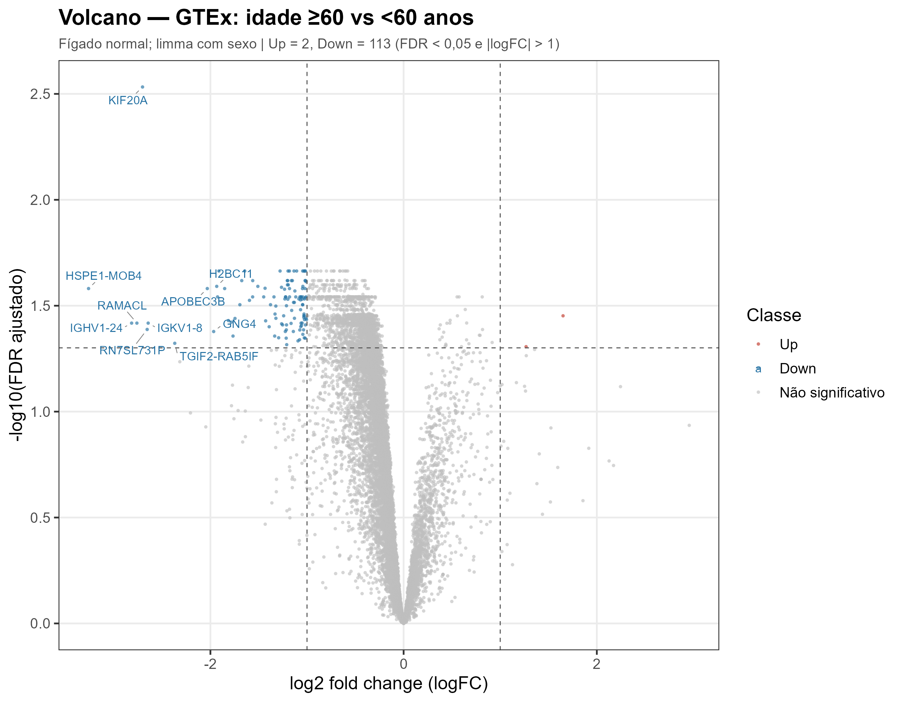

**Resultado:** 2 up e 113 down. A maioria dos genes down em ≥60 está ligada a
ciclo celular/proliferação (KIF20A, TOP2A, RRM2) e endotélio (CD93, ECSCR).
Como o fígado adulto tem baixa proliferação, esse sinal pode refletir
diferenças de composição ou de viabilidade celular, e não necessariamente
envelhecimento hepático.

### TCGA adjacente vs. GTEx normal

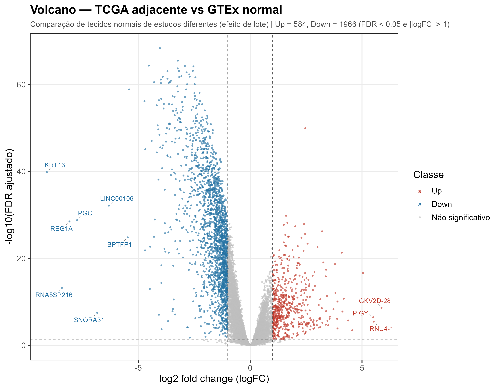

**Resultado:** 584 up e 1.966 down. É a comparação que mais evidencia o efeito
de estudo/lote em tecidos “normais”. Genes up no adjacente incluem APOC2, IGF2,
AMBP, CFP, FUCA1, ITIH2, CETP; genes down incluem CHRD, CCNL2, CLASRP,
SNRNP70, SLC17A9.

**Interpretação:** não se deve assumir que “adjacente TCGA” e “GTEx normal” são
intercambiáveis. O adjacente pode ter alterações de campo de cancerização,
inflamação e composição celular diferente; além disso, há diferenças de
processamento entre os estudos.

### Via KEGG hsa05417 (Lipídios e Aterosclerose)

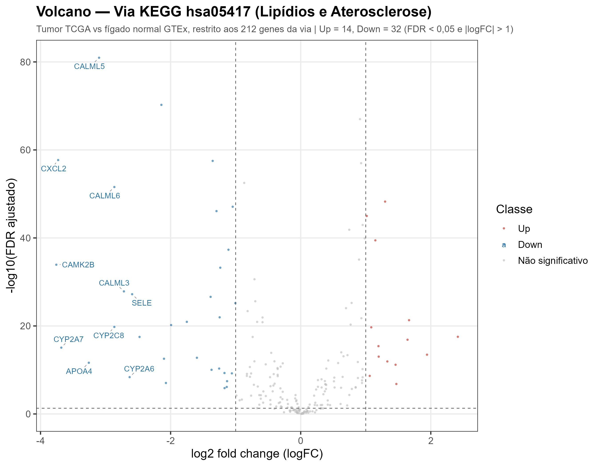

**Resultado:** 14 up e 32 down entre os 213 genes da via.

- **Up no tumor:** BAX, HSPA4, HSP90AB1, PYCARD, PPARG, MMP1, LY96, ABCG1,
  MMP9, IKBKE, CD36, VCAM1, NOX1, PIK3R2.
- **Down no tumor:** CALML5, AGER, CXCL2, MIB2, CALML6, IKBKB.

**Interpretação:** a via de lipídios e aterosclerose está remodelada no HCC,
com ativação de componentes inflamatórios/oxidativos (PYCARD, LY96, VCAM1,
NOX1, MMP1/MMP9) e alteração de receptores de lipídios (CD36, ABCG1, PPARG).
A interpretação é limitada pelo pequeno número de genes da via e pelo
confundimento TCGA × GTEx.

### TCGA vs. GTEx após ComBat (demonstração auditada)

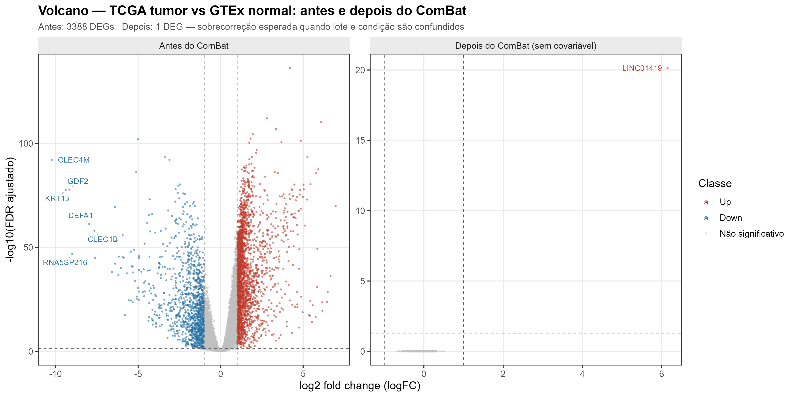

**Resultado:** a figura agora é um painel duplo: **antes do ComBat** (3.388
DEGs) e **depois do ComBat** (1 DEG, LINC01419). A versão original, com apenas
o painel “depois”, parecia vazia.

**Auditoria:** a figura original não estava tecnicamente em branco — tinha
≈3,65% de pixels não brancos (eixos, título e poucos pontos), mas 12.400 dos
12.401 genes ficaram amontoados perto da origem. A causa era científica: o
ComBat sem covariável removeu também a diferença tumor-normal, pois lote e
condição são perfeitamente confundidos. A versão corrigida tem ≈9,48% de
pixels não brancos e comunica explicitamente a sobrecorreção.

**Interpretação:** não é um resultado biológico; é uma demonstração de
**sobrecorreção**. Veja `docs/02_ComBat.md` e
`auditorias/AUDITORIA_VOLCANO_12.md` para a explicação completa.

---

## 4.4 Como os volcano plots foram gerados

Fluxo resumido:

1. Ajuste do modelo `limma` para cada comparação:
   ```r
   design <- model.matrix(~ 0 + grupo + sexo + idade, data = metadados)
   fit <- lmFit(expr, design)
   fit2 <- contrasts.fit(fit, contraste)
   fit2 <- eBayes(fit2, trend = TRUE, robust = TRUE)
   tt <- topTable(fit2, coef = 1, number = Inf, adjust.method = "BH")
   ```
2. Classificação:
   ```r
   regulation <- ifelse(adj.P.Val < 0.05 & logFC >  1, "Up",
                 ifelse(adj.P.Val < 0.05 & logFC < -1, "Down", "NS"))
   ```
3. Volcano:
   ```r
   ggplot(tt, aes(x = logFC, y = -log10(adj.P.Val), colour = regulation)) +
     geom_point() +
     geom_vline(xintercept = c(-1, 1), linetype = "dashed") +
     geom_hline(yintercept = -log10(0.05), linetype = "dashed") +
     geom_text_repel(data = rotulos, aes(label = gene))
   ```
4. Os genes rotulados são os DEGs com maior |logFC|, complementados por
   marcadores de interesse (AFP, GPC3, MMP9, VIM, CDH1, BIRC5 etc.).

### Por que usar FDR no eixo y?

Com 12.401 genes, usar o p-valor nominal geraria muitos falsos positivos. O
FDR (BH) controla a proporção esperada de falsos positivos entre os genes
chamados de significativos. No volcano, `−log10(FDR)` torna a significância
visualmente comparável entre comparações.

### Por que alguns genes conhecidos não aparecem rotulados?

O rótulo é limitado aos 10 DEGs com maior |logFC| + genes de interesse. Genes
com |logFC| menor, mas ainda significativos (por exemplo, AFP na comparação
tumor vs. adjacente), podem estar no gráfico sem rótulo. Consulte as tabelas
completas em `resultados/tabelas/DE/`.

---

## 4.5 Tabela-resumo dos contrastes

| Comparação | n testados | Up | Down | Total | % significativos |
|---|---:|---:|---:|---:|---:|
| TCGA tumor vs. TCGA adjacente | 12.401 | 3.322 | 808 | 4.130 | 33,3 |
| TCGA tumor vs. adjacente (pareado) | 12.401 | 2.934 | 776 | 3.710 | 29,9 |
| TCGA tumor vs. GTEx normal | 12.401 | 2.245 | 1.143 | 3.388 | 27,3 |
| TCGA adjacente vs. GTEx normal | 12.401 | 584 | 1.966 | 2.550 | 20,6 |
| TCGA masculino vs. feminino | 12.401 | 155 | 64 | 219 | 1,8 |
| TCGA G3–G4 vs. G1–G2 | 12.401 | 61 | 111 | 172 | 1,4 |
| GTEx ≥60 vs. <60 | 12.401 | 2 | 113 | 115 | 0,9 |
| TCGA ≥65 vs. <65 | 12.401 | 43 | 30 | 73 | 0,6 |
| TCGA estágio III–IV vs. I–II | 12.401 | 3 | 43 | 46 | 0,4 |
| Via LA: TCGA tumor vs. GTEx | 213 | 14 | 32 | 46 | 21,6 |
| Via LA: TCGA tumor vs. adjacente | 213 | 11 | 33 | 44 | 20,7 |
| GTEx masculino vs. feminino | 12.401 | 8 | 5 | 13 | 0,1 |

Critério: FDR < 0,05 e |logFC| > 1.

---

## 4.6 Limitações dos volcano plots

1. **Não mostram o tamanho amostral** nem a precisão de cada gene.
2. **O eixo y depende do ajuste de múltiplas comparações**; comparações com
   mais genes testados podem parecer “menos significativas”.
3. **Genes com baixa expressão** podem ter `logFC` instável; o filtro de
   expressão ajuda, mas não elimina o problema.
4. **Confundimento de lote** não aparece no gráfico: um ponto up pode ser
   biologia ou lote.
5. **O critério |logFC| > 1 é arbitrário**; para fins clínicos, podem ser
   relevantes efeitos menores.
6. **Volcano não substitui validação** por qPCR, IHC ou coortes independentes.

---

## 4.7 Resumo

- Os três volcano plots principais mostram:
  1. **LIHC TCGA** (tumor vs. adjacente): perda de identidade hepática e ganho
     de proliferação/remodelamento;
  2. **GTEx** (masculino vs. feminino): genes do cromossomo Y e XIST, um
     controle positivo;
  3. **TCGA vs. GTEx** (tumor vs. fígado normal): o maior conjunto de DEGs, mas
     confundido com estudo/lote.
- Os volcano complementares mostram que **grau** tem assinatura de ciclo
  celular, **estágio avançado** perde genes metabólicos e ganha hipóxia, e a
  **via LA** está remodelada no tumor.
- A interpretação biológica deve sempre considerar o desenho, as covariáveis e
  o confundimento.
