# 8. Fenótipos clínicos avançados, sobrevida e Cox

> Arquivo: `docs/08_fenotipos_avancados.md`.
> Script: `scripts/05_fenotipos_avancados.R`.
> Saídas: `resultados/tabelas/13–20_*.csv`, `resultados/figuras/15–25_*.png`.

---

## 8.1 Objetivo

A análise exploratória inicial descreveu sexo, idade, estágio e grau. Esta
etapa amplia a exploração clínica do TCGA-LIHC para:

- quantificar **missingness** e qualidade das variáveis;
- testar associações entre fenótipos;
- explorar **AFP**, **fibrose**, **sorologia viral**, **Child-Pugh**,
  **histologia**, **invasão vascular** e **raça/etnia**;
- analisar **sobrevida global** com Kaplan-Meier e log-rank;
- ajustar modelos de **Cox univariados e multivariados**;
- verificar a suposição de **riscos proporcionais** (`cox.zph`);
- medir correlações entre variáveis clínicas.

Todos os resultados são **exploratórios** e observacionais.

---

## 8.2 Missingness

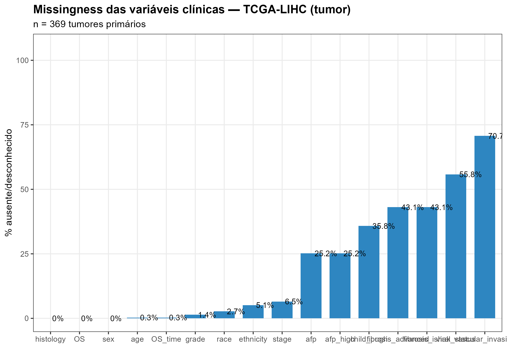

*Figura 16. Percentual de valores ausentes/desconhecidos nas variáveis clínicas
dos 369 tumores primários TCGA.*

| Variável | Ausente/desconhecido | % |
|---|---:|---:|
| Invasão vascular | 261 | 70,7 |
| Sorologia viral | 206 | 55,8 |
| Fibrose (Ishak) | 159 | 43,1 |
| Fibrose avançada | 159 | 43,1 |
| Child-Pugh | 132 | 35,8 |
| AFP | 93 | 25,2 |
| AFP ≥400 | 93 | 25,2 |
| Estágio | 24 | 6,5 |
| Etnia | 19 | 5,1 |
| Raça | 10 | 2,7 |
| Grau | 5 | 1,4 |
| Idade | 1 | 0,3 |
| OS/time | 1 | 0,3 |
| Sexo, histologia | 0 | 0 |

**Implicação:** as análises de AFP, fibrose, Child-Pugh, vírus e invasão
vascular têm poder limitado e podem sofrer viés de seleção (amostras com
informação disponível podem não ser representativas).

---

## 8.3 Associações entre fenótipos

A tabela completa está em
`resultados/tabelas/14_fenotipos_testes.csv` (24 testes, com p nominal, p
ajustado por BH e V de Cramér). Para as variáveis **vírus** e **raça**, a
categoria `Unknown` foi excluída dos testes, pois não representa um grupo
biológico.

### Associações significativas (BH < 0,05)

| Associação | n | Teste | p | V de Cramér |
|---|---:|---|---:|---:|
| Child-Pugh × estágio | 345 | Qui-quadrado | 5,5 × 10⁻⁸ | 0,293 |
| log2(AFP+1) × grau | 275 | Wilcoxon | 4,3 × 10⁻⁶ | — |
| AFP ≥400 × grau | 275 | Qui-quadrado | 2,0 × 10⁻⁵ | 0,257 |
| Raça × grau (Unknown excluído) | 355 | Fisher | 1,0 × 10⁻⁴ | 0,251 |
| Idade × grau | 363 | Wilcoxon | 4,9 × 10⁻³ | — |
| log2(AFP+1) × sexo | 276 | Wilcoxon | 5,4 × 10⁻³ | — |
| Fibrose Ishak × estágio | 199 | Wilcoxon | 6,7 × 10⁻³ | — |
| Vírus × grau (Unknown excluído) | 161 | Qui-quadrado | 1,1 × 10⁻² | 0,236 |
| AFP ≥400 × estágio | 263 | Qui-quadrado | 1,4 × 10⁻² | 0,152 |
| Fibrose avançada × estágio | 199 | Qui-quadrado | 1,4 × 10⁻² | 0,174 |
| Vírus × estágio (Unknown excluído) | 156 | Qui-quadrado | 1,4 × 10⁻² | 0,233 |

### Associações não significativas

- **Sexo × estágio** (p = 0,163) e **sexo × grau** (p = 0,404).
- **Idade × estágio** (p = 0,035; BH = 0,060) e **idade × sexo** (p = 0,089).
- **Invasão vascular × estágio** (p = 0,079) e **× grau** (p = 0,363).
- **Fibrose × grau** (p = 0,504).
- **Histologia HCC vs. outro × estágio** (p = 1,0).

**Interpretação:**

- **Child-Pugh** e **estágio** estão fortemente associados: pacientes com
  doença mais avançada têm pior função hepática.
- **AFP** se associa mais ao **grau** (ρ = 0,292) do que ao estágio
  (ρ = 0,162), consistente com produção de AFP em tumores menos
  diferenciados.
- **Fibrose** se associa ao estágio, mas não ao grau.
- **Sexo** não se associa a estágio/grau nesta coorte.
- A associação **raça × grau** deve ser interpretada com cautela: raça é uma
  construção social e pode refletir ancestralidade, acesso ao cuidado e
  diferenças de recrutamento.

---

## 8.4 AFP

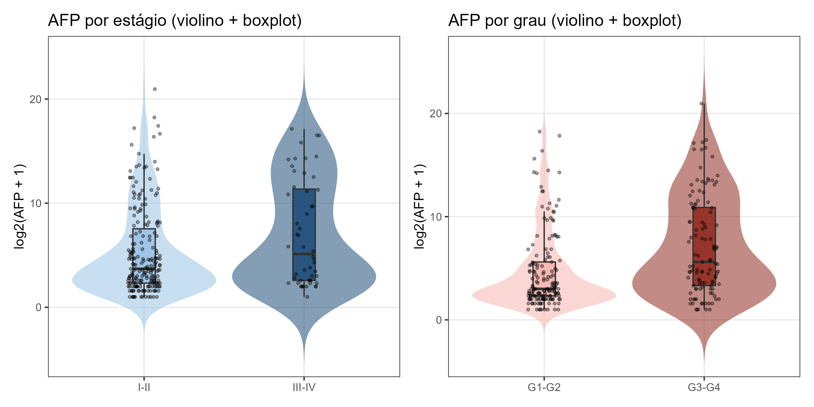

*Figura 15. log2(AFP + 1) por estágio agrupado e por grau agrupado (violino + boxplot).*

Medianas de AFP (ng/mL):

| Subgrupo | n | Mediana | Q1–Q3 |
|---|---:|---:|---:|
| Estágio I–II | 211 | 12,0 | 4,0–188,5 |
| Estágio III–IV | 52 | 34,5 | 5,0–2.628,8 |
| Grau G1–G2 | 162 | 7,0 | 4,0–47,8 |
| Grau G3–G4 | 113 | 48,0 | 9,0–1.902,0 |
| Feminino | 91 | 28,0 | 6,0–805,0 |
| Masculino | 185 | 11,0 | 4,0–120,0 |

A **média** de AFP é muito inflada por outliers (por exemplo, média de
14.622 ng/mL no estágio I–II), por isso a interpretação usa **mediana** e
**log2(AFP+1)**.

---

## 8.5 Sobrevida global (Kaplan-Meier)

Foram usados 363 tumores com `OS_time > 0` e `OS` informado; 128 eventos.

| Variável | n | Eventos | log-rank p |
|---|---:|---:|---:|
| Estágio (I–II vs. III–IV) | 339 | 114 | **5,18 × 10⁻⁷** |
| Grau (G1–G2 vs. G3–G4) | 358 | 124 | 0,682 |
| Sexo | 363 | 128 | 0,288 |
| Idade (≥65 vs. <65) | 363 | 128 | 0,244 |
| AFP (≥400 vs. <400) | 274 | 82 | 0,941 |
| Fibrose avançada (Ishak ≥5) | 207 | 62 | 0,428 |

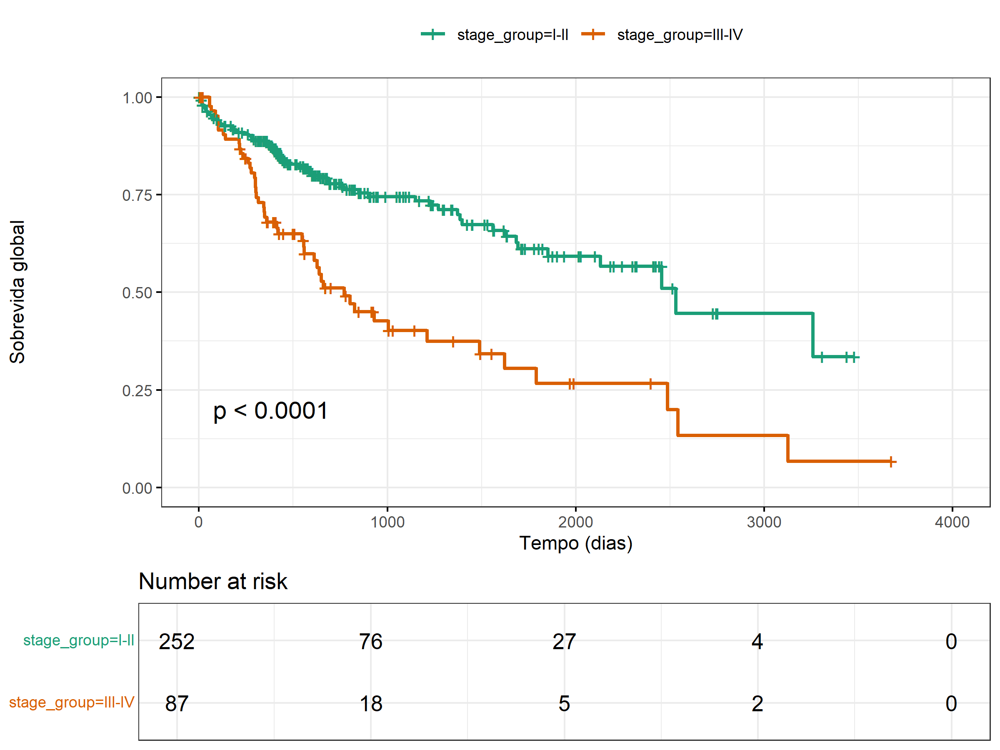

*Figura 17. Sobrevida global por estágio.*

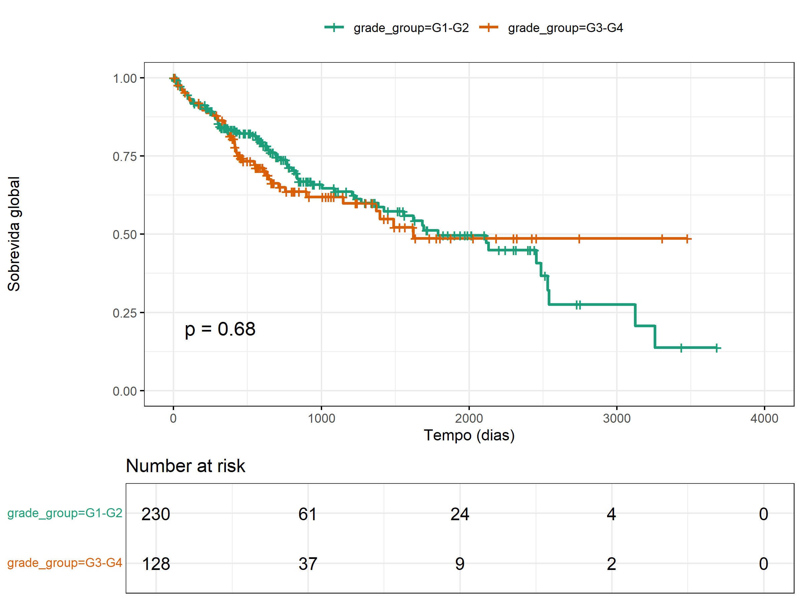

*Figura 18. Sobrevida global por grau.*

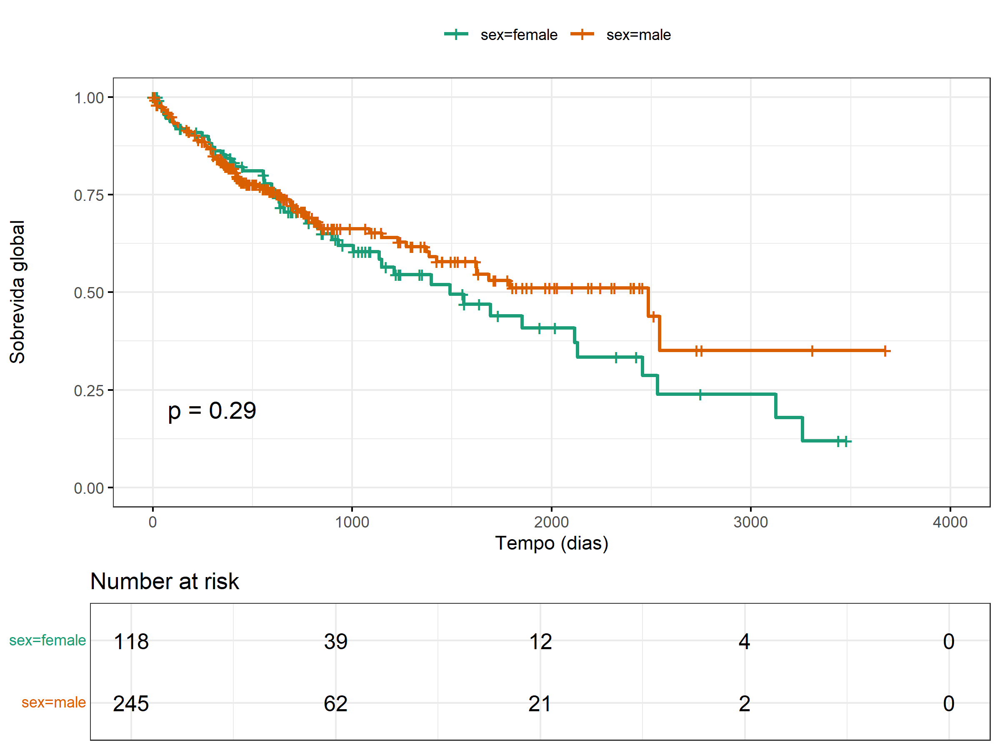

*Figura 19. Sobrevida global por sexo.*

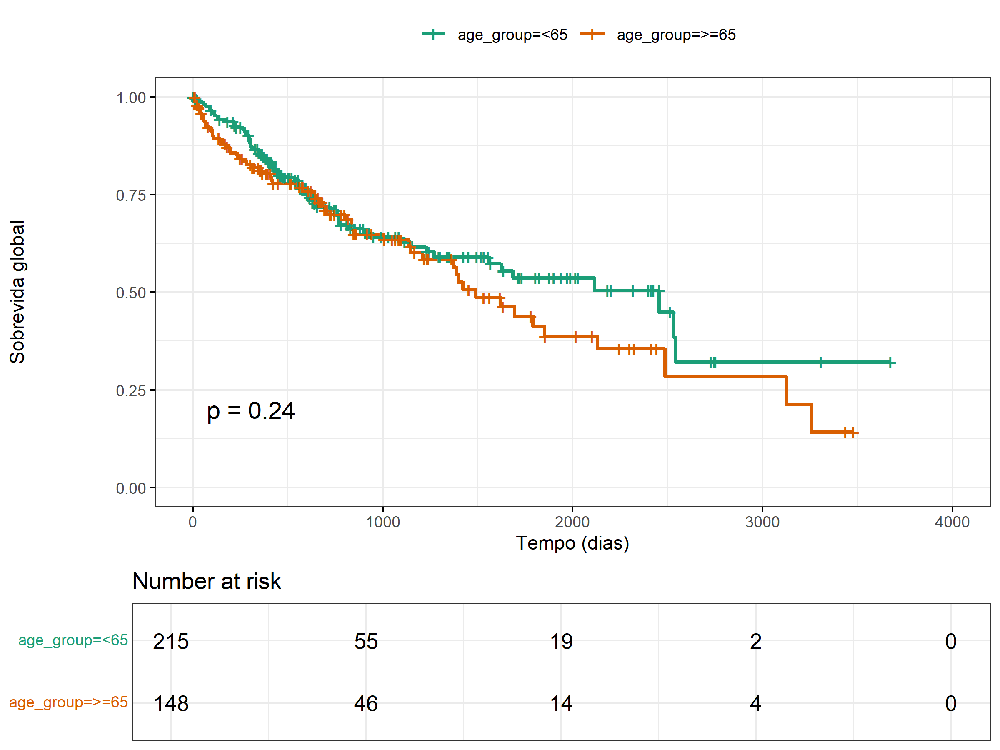

*Figura 20. Sobrevida global por idade.*

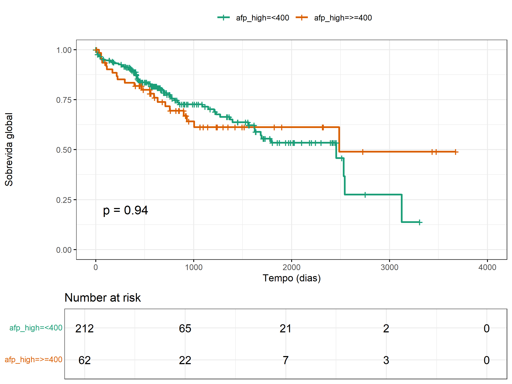

*Figura 21. Sobrevida global por AFP.*

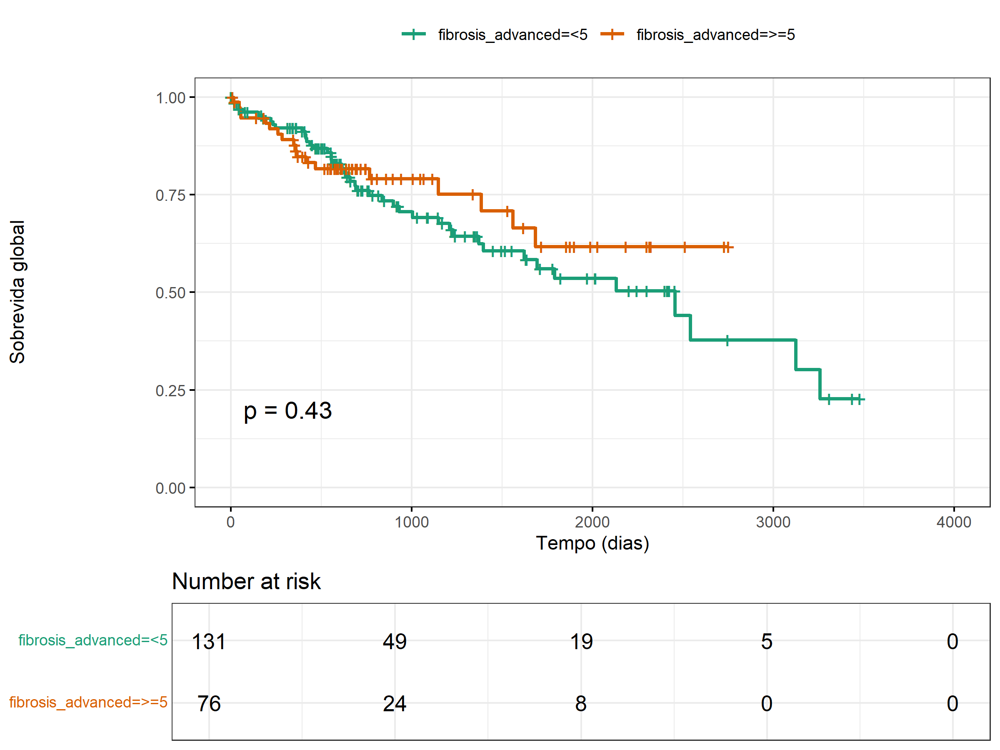

*Figura 22. Sobrevida global por fibrose.*

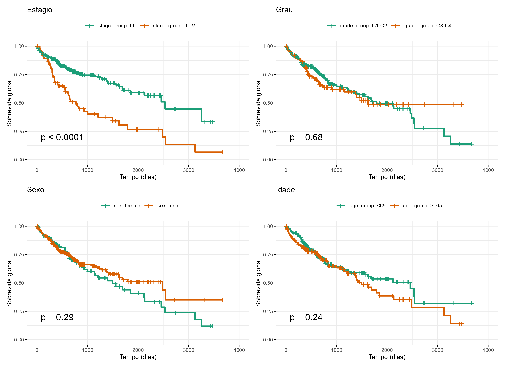

*Figura 23. Painel comparativo das curvas de estágio, grau, sexo e idade.*

**Interpretação:** apenas o **estágio** separou claramente as curvas de
sobrevida. A ausência de significância para grau, AFP e fibrose pode refletir
tanto ausência de efeito prognóstico independente quanto perda de poder por
missingness e heterogeneidade.

---

## 8.6 Cox univariado

A tabela completa está em `resultados/tabelas/17_cox_univariado.csv`.

| Variável | HR (IC 95%) | p |
|---|---|---:|
| Estágio III–IV vs. I–II | 2,52 (1,73–3,66) | 1,2 × 10⁻⁶ |
| Grau G3–G4 vs. G1–G2 | 1,08 (0,75–1,55) | 0,682 |
| Sexo masculino vs. feminino | 0,82 (0,58–1,18) | 0,290 |
| Idade (por ano) | 1,012 (0,998–1,026) | 0,094 |
| AFP ≥400 vs. <400 | 1,02 (0,62–1,68) | 0,939 |
| Fibrose avançada vs. não | 0,80 (0,46–1,39) | 0,429 |
| Vírus HBV vs. nenhum/outro | 0,44 (0,25–0,76) | 3,1 × 10⁻³ |
| Vírus HCV vs. nenhum/outro | 0,57 (0,24–1,34) | 0,196 |
| Child-Pugh B–C vs. A | 2,36 (1,67–3,35) | 1,5 × 10⁻⁶ |

**Atenção:** o HR de HBV <1 no modelo univariado pode refletir confundimento
por estágio, função hepática e vigilância (diagnóstico mais precoce em
pacientes com HBV), e não um efeito protetor causal. O termo HBV+HCV não foi
estimável (ausência de eventos suficientes em uma das categorias). No modelo
multivariado, que não inclui vírus, o estágio permanece dominante.

---

## 8.7 Cox multivariado

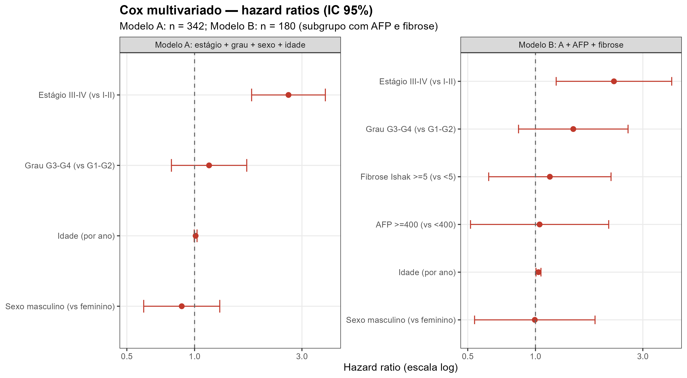

*Figura 24. Hazard ratios do Cox multivariado (Modelos A e B).*

### Modelo A: estágio + grau + sexo + idade

n = 337; 112 eventos.

| Termo | HR (IC 95%) | p |
|---|---|---:|
| Estágio III–IV vs. I–II | 2,61 (1,79–3,81) | 6,0 × 10⁻⁷ |
| Grau G3–G4 vs. G1–G2 | 1,16 (0,79–1,71) | 0,450 |
| Sexo masculino vs. feminino | 0,88 (0,59–1,29) | 0,508 |
| Idade (por ano) | 1,011 (0,996–1,026) | 0,155 |

### Modelo B: Modelo A + AFP + fibrose

n = 179; 52 eventos.

| Termo | HR (IC 95%) | p |
|---|---|---:|
| Estágio III–IV vs. I–II | 2,23 (1,24–4,03) | 7,7 × 10⁻³ |
| Grau G3–G4 vs. G1–G2 | 1,47 (0,84–2,58) | 0,176 |
| Sexo masculino vs. feminino | 0,99 (0,54–1,84) | 0,983 |
| Idade (por ano) | 1,031 (1,006–1,058) | 0,0165 |
| AFP ≥400 vs. <400 | 1,04 (0,51–2,12) | 0,907 |
| Fibrose avançada vs. não | 1,16 (0,62–2,17) | 0,645 |

**Interpretação:** o estágio é o preditor independente mais forte. O grau perde
significância após ajuste pelo estágio. No Modelo B, a idade aparece como fator
independente (HR ≈ 1,03 por ano), mas o modelo tem apenas 52 eventos e n = 179;
o achado é frágil. AFP e fibrose não foram independentes após ajuste.

---

## 8.8 Riscos proporcionais (`cox.zph`)

| Modelo | Termo | χ² | p |
|---|---|---:|---:|
| A | Estágio | 0,53 | 0,465 |
| A | Grau | 0,43 | 0,514 |
| A | Sexo | 2,70 | 0,100 |
| A | Idade | 0,39 | 0,532 |
| A | **GLOBAL** | 4,15 | **0,386** |
| B | Estágio | 2,17 | 0,141 |
| B | Grau | 0,86 | 0,355 |
| B | Sexo | 1,39 | 0,238 |
| B | Idade | 0,09 | 0,758 |
| B | AFP | 3,88 | 0,049 |
| B | Fibrose | 2,07 | 0,150 |
| B | **GLOBAL** | 9,38 | **0,153** |

Não há evidência global de violação da suposição de riscos proporcionais. AFP
no Modelo B está no limite (p = 0,049), o que merece cautela.

---

## 8.9 Correlações clínicas

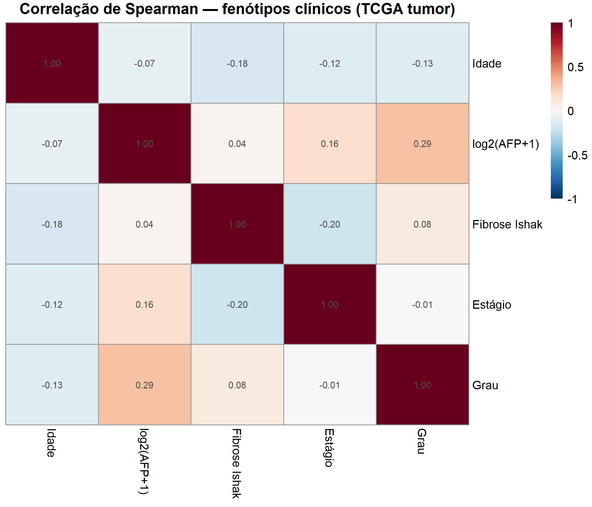

*Figura 25. Correlações de Spearman entre idade, AFP, fibrose, estágio e grau.*

| Par | ρ | p | n |
|---|---:|---:|---:|
| AFP × grau | 0,292 | 8,6 × 10⁻⁷ | 275 |
| AFP × estágio | 0,162 | 0,0083 | 263 |
| Fibrose × estágio | −0,205 | 0,0038 | 199 |
| Idade × grau | −0,131 | 0,0126 | 363 |
| Idade × estágio | −0,122 | 0,0235 | 344 |
| Idade × fibrose | −0,176 | 0,0109 | 209 |
| Fibrose × grau | 0,083 | 0,231 | 208 |
| Estágio × grau | −0,009 | 0,875 | 343 |

**Interpretação:** AFP e grau compartilham parte da variação; fibrose e estágio
são inversamente correlacionados (possivelmente porque pacientes com cirrose
avançada são diagnosticados em estágios diferentes ou têm maior mortalidade
competitiva). A correlação estágio × grau é praticamente nula, sugerindo que
eles capturam dimensões parcialmente distintas.

---

## 8.10 Limitações

1. **Missingness** elevado em invasão vascular, sorologia, fibrose e AFP.
2. **Viés de seleção:** a coorte TCGA é cirúrgica, majoritariamente estágio
   I–II; os resultados não se generalizam para todos os HCC.
3. **Dados observacionais:** associações não implicam causalidade.
4. **Múltiplos testes:** usamos BH, mas as análises são exploratórias.
5. **Categorizações:** estágio I–II vs. III–IV e grau G1–G2 vs. G3–G4 são
   escolhas pragmáticas; outros cortes podem mudar o poder.
6. **AFP:** distribuição muito assimétrica; mediana/log2 são mais adequados.
7. **Sobrevida:** não ajustamos para tratamento, performance status, função
   hepática detalhada ou causas competitivas de morte.
8. **Raça/etnia:** categorias pequenas e heterogêneas; interpretar com cautela.

---

## 8.11 Resumo

- O **estágio** é o fator prognóstico dominante na coorte TCGA-LIHC.
- **AFP** se associa a **grau**, não a estágio de forma independente.
- **Child-Pugh** e **fibrose** se associam ao estágio, refletindo função
  hepática e doença de base.
- **Sexo** não se associou a estágio, grau ou sobrevida nesta coorte.
- A **missingness** limita as conclusões sobre AFP, fibrose, vírus e invasão
  vascular.
- Os modelos de Cox não mostram violação global de riscos proporcionais.
