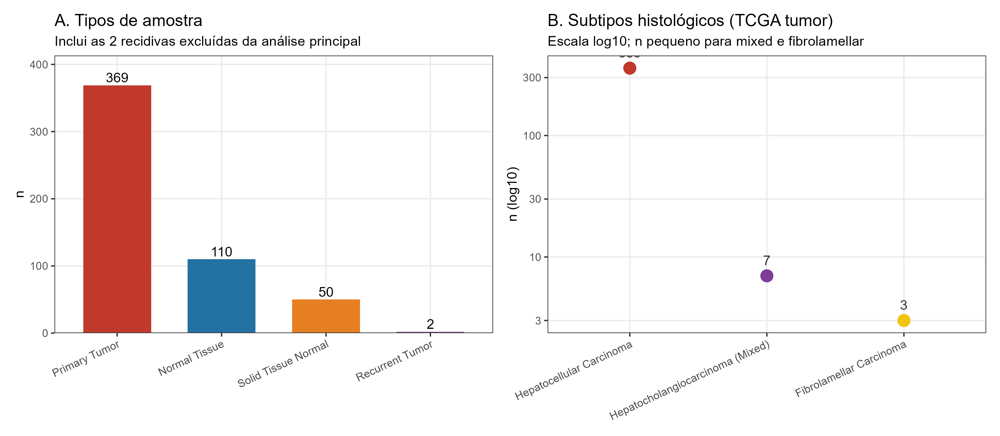
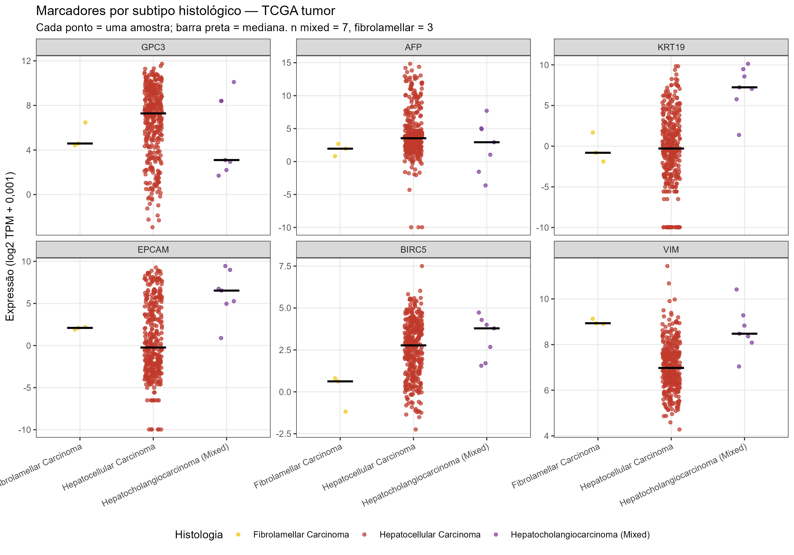

# 10. Outros grupos dentro dos dados

> Arquivo: `docs/10_grupos_alternativos.md`.
> Script: `scripts/06_grupos_alternativos.R`.
> Saídas: `resultados/tabelas/21–22_*.csv`,
> `resultados/figuras/26–27_*.png`.

---

## 10.1 Resposta curta

Sim. Além de **tumor primário**, **tecido adjacente** e **fígado normal GTEx**,
os dados contêm:

1. **Tumores recidivados** (`Recurrent Tumor`, n = 2);
2. **subtipos histológicos** dentro do TCGA:
   - carcinoma hepatocelular clássico (n = 359);
   - carcinoma hepatocolangiocarcinoma misto (n = 7);
   - carcinoma fibrolamelar (n = 3);
3. **grupos de etiologia viral** (HBV, HCV, HBV+HCV, nenhum/outro, unknown);
4. **centros TCGA (TSS)**, que funcionam como grupos técnicos de lote;
5. dois grupos de tecido normal: **TCGA adjacente** e **GTEx normal**.

O grupo mais “escondido” é o de **recidivas**: ele aparece no arquivo bruto,
mas foi excluído da análise principal. Os subtipos histológicos e os grupos
virais são grupos biológicos reais, mas pequenos ou com missingness elevado.

---

## 10.2 Inventário

*Figura 26. (A) Tipos de amostra, incluindo as 2 recidivas. (B) Subtipos
histológicos no TCGA tumor (escala log10).*

| Categoria | Grupo | n | % |
|---|---|---:|---:|
| Tipo de amostra | Tumor primário | 369 | 69,5 |
| Tipo de amostra | Tecido adjacente | 50 | 9,4 |
| Tipo de amostra | GTEx normal | 110 | 20,7 |
| Tipo de amostra | **Recidiva** | **2** | **0,4** |
| Histologia (TCGA tumor) | HCC clássico | 359 | 97,3 |
| Histologia (TCGA tumor) | Hepatocolangiocarcinoma misto | 7 | 1,9 |
| Histologia (TCGA tumor) | Fibrolamelar | 3 | 0,8 |
| Sorologia viral (TCGA tumor) | HBV | 59 | 16,0 |
| Sorologia viral (TCGA tumor) | HCV | 19 | 5,1 |
| Sorologia viral (TCGA tumor) | HBV+HCV | 85 | 23,0 |
| Sorologia viral (TCGA tumor) | Unknown | 206 | 55,8 |

Além disso, há **38 centros TCGA (TSS)**; o maior é `DD` (n = 144; 39,0% dos
tumores), seguido de `CC` e `G3` (n = 32 cada). Isso é relevante como possível
fonte de efeito de lote técnico, embora não tenha sido usado como covariável
nas análises principais.

---

## 10.3 Recidivas

As 2 amostras `TCGA-DD-AACA-02` e `TCGA-ZS-A9CF-02` são **tumores
recidivados**, não primários. Foram excluídas porque:

- o desenho principal é tumor primário vs. tecido adjacente/normal;
- n = 2 não permite análise estatística robusta;
- recidivas podem ter biologia distinta (resistência, evolução clonal).

Elas estão mantidas em `metadata_amostras.tsv` para auditoria, mas não em
`metadata_analise.tsv`.

---

## 10.4 Subtipos histológicos

O TCGA-LIHC contém, além do HCC clássico:

- **Hepatocolangiocarcinoma misto** (n = 7): tumor com componente
  hepatocelular e colangiocelular;
- **Carcinoma fibrolamelar** (n = 3): variante rara, geralmente em pacientes
  jovens, com biologia distinta.

Com n = 7 e n = 3, **não é adequado rodar expressão diferencial inferencial**
contra o HCC clássico. A análise é descritiva.

*Figura 27. Expressão de marcadores por subtipo histológico. Cada ponto é uma
amostra; a barra preta é a mediana. Interpretar com cautela devido ao n
pequeno.*

Medianas de expressão (log2 TPM + 0,001):

| Gene | HCC clássico (n = 359) | Misto (n = 7) | Fibrolamelar (n = 3) |
|---|---:|---:|---:|
| GPC3 | 7,28 | 3,10 | 4,58 |
| AFP | 3,53 | 2,93 | 1,95 |
| KRT19 | −0,28 | **7,24** | −0,81 |
| EPCAM | −0,23 | **6,53** | 2,10 |
| BIRC5 | 2,77 | 3,79 | 0,62 |
| VIM | 6,98 | 8,48 | 8,94 |

**Interpretação descritiva:**

- O grupo **misto** tem expressão muito alta de **KRT19** e **EPCAM**,
  consistente com o componente colangiocelular/ductal.
- O grupo **fibrolamelar** tem AFP e GPC3 mais baixos e VIM alto, mas n = 3
  impede conclusões.
- O HCC clássico tem a maior mediana de GPC3, coerente com o marcador
  hepatocelular.
- Esses achados são **hipóteses exploratórias**, não resultados confirmatórios.

---

## 10.5 Grupos virais

A sorologia viral disponível no TCGA mostra:

- **HBV+HCV:** 85 tumores (23,0%);
- **HBV:** 59 (16,0%);
- **HCV:** 19 (5,1%);
- **Unknown:** 206 (55,8%).

O grupo `Unknown` é grande e não deve ser interpretado como “sem infecção”.
Nas análises de fenótipos, a categoria `Unknown` foi excluída dos testes de
associação e do Cox univariado. A etiologia viral pode ser usada como
estratificação em análises futuras, mas o missingness limita o poder.

---

## 10.6 Centros TCGA (TSS)

Os 38 centros TCGA são um grupo **técnico**, não biológico. O centro `DD`
contribui com 39% dos tumores; centros com n = 1–3 são muitos. Isso pode gerar
efeito de lote. Não aplicamos ComBat por TSS porque:

- o efeito de lote principal neste estudo é TCGA vs. GTEx;
- o número de amostras por centro é muito desigual;
- o desenho não foi pré-especificado para correção por TSS.

Ainda assim, o TSS é um candidato natural para análises de sensibilidade
futuras (por exemplo, incluí-lo como efeito aleatório ou corrigir apenas
centros com n ≥ 10).

---

## 10.7 O que isso muda na interpretação?

- A análise principal continua válida para **tumor primário vs. adjacente vs.
  GTEx normal**.
- As recidivas não entram nas comparações principais.
- Os subtipos histológicos e virais são **grupos reais**, mas pequenos ou com
  missingness; não foram usados para inferência principal.
- A existência de 38 TSS reforça a necessidade de cautela com efeitos de lote
  e de reportar a origem das amostras.
- Uma análise futura interessante é **estratificar por etiologia viral** ou
  por **subtipo histológico** em coortes maiores.

---

## 10.8 Resumo

| Grupo | n | Pode ser analisado? |
|---|---:|---|
| Tumor primário | 369 | Sim (principal) |
| Tecido adjacente | 50 | Sim (principal) |
| GTEx normal | 110 | Sim (principal) |
| Recidiva | 2 | Não (descritivo/apenas auditoria) |
| HCC clássico | 359 | Sim |
| Misto | 7 | Apenas descritivo |
| Fibrolamelar | 3 | Apenas descritivo |
| HBV / HCV / HBV+HCV | 59 / 19 / 85 | Possível, com cautela |
| Unknown viral | 206 | Excluído dos testes |
| TSS | 38 centros | Efeito técnico; não usado |
