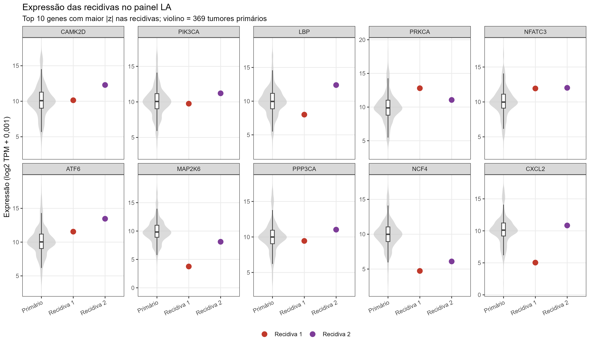
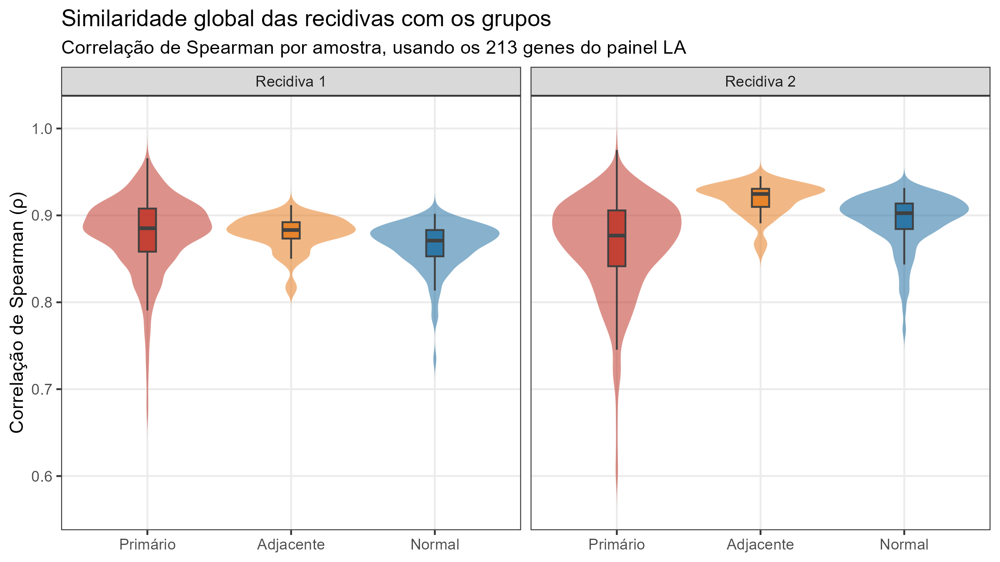
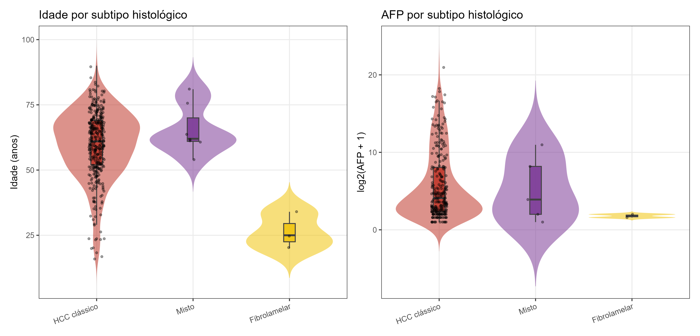
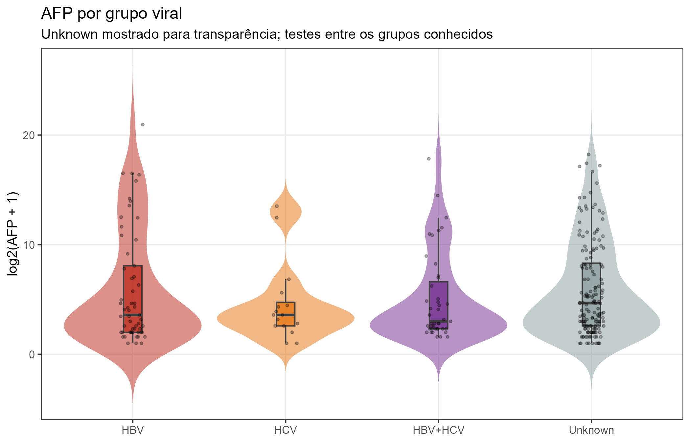
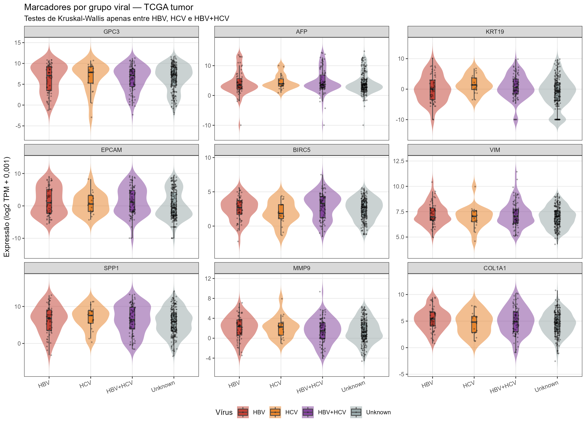
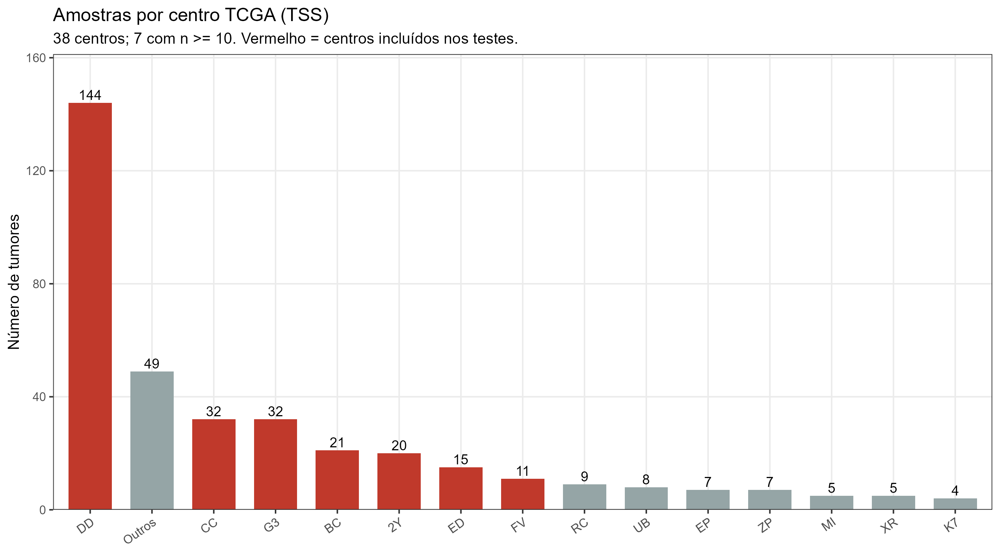
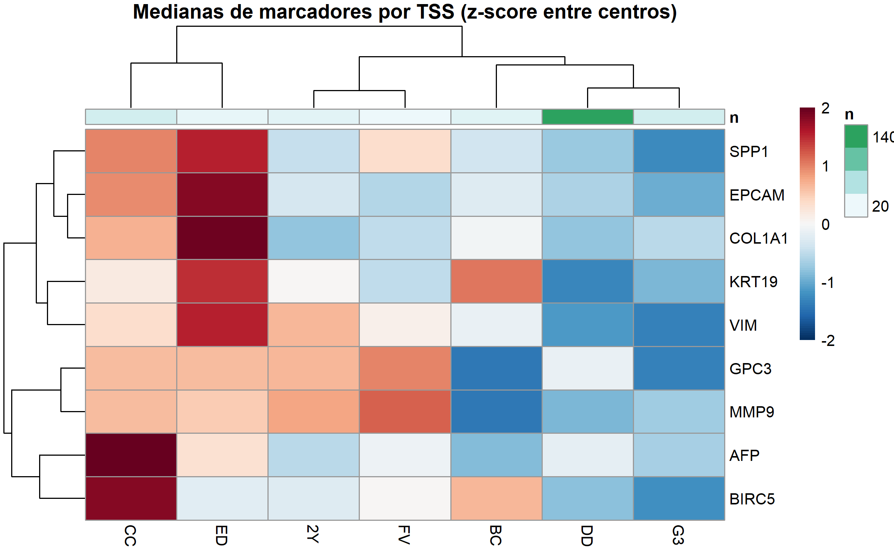
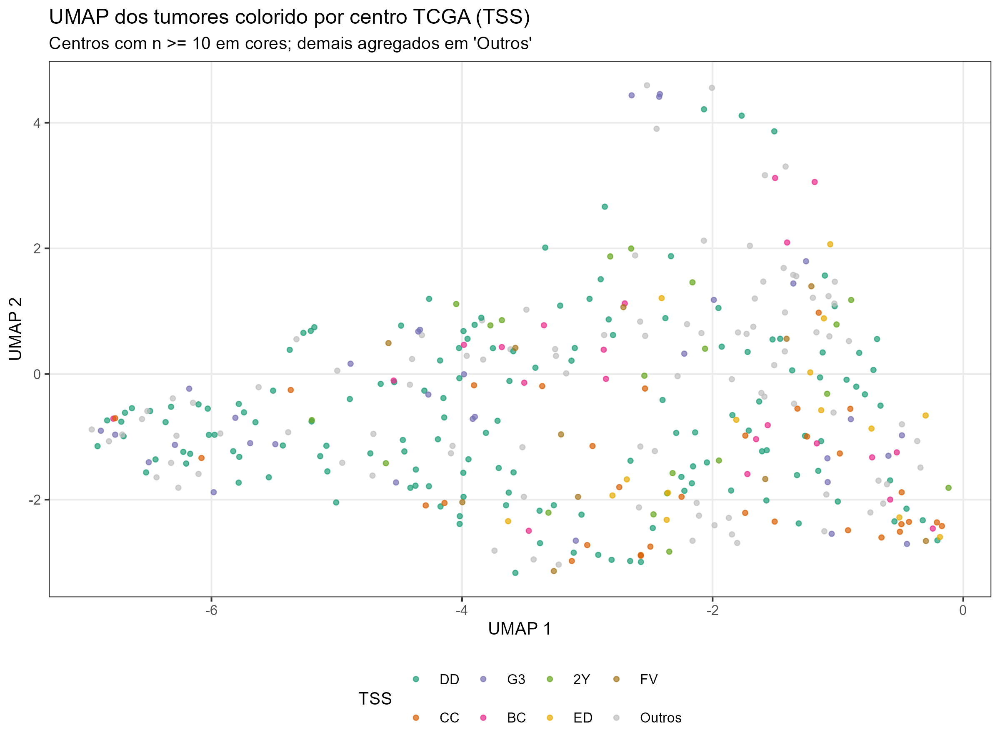

# 11. Análises separadas dos grupos alternativos

> Arquivo: `docs/11_grupos_separados.md`.
> Script: `scripts/07_grupos_separados.R`.
> Saídas: `resultados/tabelas/23–35_*.csv`,
> `resultados/figuras/28–35_*.png` e
> `resultados/qc/resumo_grupos_separados.txt`.

---

## 11.1 Princípio geral

A análise principal continua sendo **tumor primário × tecido adjacente ×
fígado normal GTEx**. Os grupos analisados neste capítulo são mantidos
**separados**, sem serem fundidos aos três grupos principais.

Como as recidivas têm n = 2, os subtipos histológicos raros têm n = 7 e n = 3,
e a sorologia viral tem 55,8% de `Unknown`, essas análises são
**descritivas/exploratórias**. Elas não substituem testes confirmatórios e não
entram no desenho principal.

| Grupo | n | Tratamento neste capítulo |
|---|---:|---|
| Tumores recidivados | 2 | Descritivo; expressão no painel LA |
| HCC clássico | 359 | Referência dos subtipos |
| Hepatocolangiocarcinoma misto | 7 | Descritivo/exploratório |
| Carcinoma fibrolamelar | 3 | Descritivo/exploratório |
| HBV | 59 | Exploratório, com `Unknown` separado |
| HCV | 19 | Exploratório, com `Unknown` separado |
| HBV+HCV | 85 | Exploratório, com `Unknown` separado |
| Unknown viral | 206 | Mostrado, mas excluído dos testes virais |
| Centros TCGA (TSS) | 38 | Grupo técnico de lote |

---

## 11.2 Tumores recidivados (n = 2)

### 11.2.1 Clínica

As duas amostras `Recurrent Tumor` são:

| Amostra | Idade | Sexo | Estágio | Grau | AFP | Fibrose Ishak | Vírus | Óbito | TSS |
|---|---:|---|---|---|---:|---:|---|---|---|
| `TCGA-DD-AACA-02` | 65 | masculino | I | G3 | 7 | 6 | Unknown | não | DD |
| `TCGA-ZS-A9CF-02` | 64 | masculino | II | G2 | NA | 0 | HBV+HCV | não | ZS |

Comparação descritiva com os 369 tumores primários:

| Variável | Recidiva 1 | Recidiva 2 | Primários (n = 369) |
|---|---|---|---|
| Idade (anos) | 65,0 | 64,0 | 61,0 (51,8–69,0) |
| Sexo masculino | sim | sim | 249 (67,5%) |
| Estágio I–II | sim | sim | 255 (73,9%) |
| Grau G3–G4 | sim | não | 132 (36,3%) |
| AFP (ng/mL) | 7,0 | NA | 15,5 (4,0–270,5) |
| Fibrose Ishak | 6,0 | 0,0 | 3,0 |
| Vírus detectável | não (Unknown) | sim (HBV+HCV) | 163 (44,2%) |
| Óbito | não | não | 128 (34,7%) |

Tabelas completas: `resultados/tabelas/23_recidivas_clinico.csv` e
`resultados/tabelas/24_recidivas_comparacao.csv`.

As duas recidivas são homens, com estágios iniciais (I e II), graus G3/G2 e
ambos vivos no último seguimento (2.301 e 2.412 dias). A idade e o estágio não
são atípicos em relação aos primários, mas **n = 2 não permite qualquer
inferência**.

### 11.2.2 Expressão no painel LA

A matriz completa (`expressao_log2tpm_filtrada.tsv.gz`) contém 529 amostras e
**não inclui as recidivas `-02`**. Por isso, a expressão das recidivas foi
analisada no **painel LA** (`expressao_LA_pathway.tsv.gz`, 213 genes), que
contém as 531 amostras.

Para cada gene, calcularam-se o z-score e o percentil da recidiva em relação
aos 369 tumores primários. A figura mostra os 10 genes com maior |z| em pelo
menos uma recidiva.



*Figura 28. Top 10 genes do painel LA com maior |z| nas recidivas. Violino =
distribuição dos 369 tumores primários; pontos = recidivas.*

Principais extremos (tabela completa em
`resultados/tabelas/25_recidivas_expressao.csv`):

| Recidiva | Gene | z | Percentil entre primários |
|---|---|---:|---:|
| `TCGA-DD-AACA-02` | LBP | −2,85 | 1,9 |
| `TCGA-DD-AACA-02` | PRKCA | 2,73 | 100,0 |
| `TCGA-DD-AACA-02` | NFATC3 | 2,52 | 99,2 |
| `TCGA-DD-AACA-02` | MAP2K6 | −2,41 | 0,8 |
| `TCGA-DD-AACA-02` | NCF4 | −2,34 | 0,8 |
| `TCGA-ZS-A9CF-02` | CAMK2D | 3,07 | 100,0 |
| `TCGA-ZS-A9CF-02` | PIK3CA | 2,88 | 99,7 |
| `TCGA-ZS-A9CF-02` | NFATC3 | 2,64 | 99,7 |
| `TCGA-ZS-A9CF-02` | ATF6 | 2,63 | 99,2 |
| `TCGA-ZS-A9CF-02` | PPP3CA | 2,38 | 99,5 |

Os genes extremos são do painel LA (inflamação, lipídios e sinalização), **não
são marcadores canônicos de HCC**. Alguns extremos são compartilhados
(`NFATC3` alto nas duas recidivas) e outros são específicos de uma amostra
(`LBP` muito baixo na primeira; `CAMK2D`/`PIK3CA` altos na segunda). Com n = 2,
isso é apenas uma descrição.

### 11.2.3 Similaridade global com os grupos

A correlação de Spearman foi calculada entre cada recidiva e todas as amostras
de cada grupo, usando os 213 genes do painel LA:

| Recidiva | Grupo | n | ρ mediana | ρ máximo |
|---|---|---:|---:|---:|
| `TCGA-DD-AACA-02` | Primário | 369 | 0,885 | 0,966 |
| `TCGA-DD-AACA-02` | Adjacente | 50 | 0,883 | 0,912 |
| `TCGA-DD-AACA-02` | Normal | 110 | 0,871 | 0,902 |
| `TCGA-ZS-A9CF-02` | Primário | 369 | 0,877 | 0,975 |
| `TCGA-ZS-A9CF-02` | Adjacente | 50 | 0,925 | 0,945 |
| `TCGA-ZS-A9CF-02` | Normal | 110 | 0,903 | 0,932 |



*Figura 29. Distribuição das correlações de cada recidiva com primários,
adjacentes e normais.*

As correlações medianas são altas em todos os grupos (> 0,87), como esperado
para tecido hepático. A segunda recidiva é mais próxima do tecido adjacente
(ρ = 0,925) do que dos primários (ρ = 0,877), mas isso não deve ser
interpretado como evidência biológica: são duas amostras e a diferença pode
refletir composição tecidual ou ruído.

Tabela completa: `resultados/tabelas/26_recidivas_correlacao.csv`.

**Limitações das recidivas:** n = 2; apenas o painel LA; ausência de metadados
de tratamento prévio; as recidivas não foram emparelhadas com o tumor primário
do mesmo paciente na matriz disponível.

---

## 11.3 Subtipos histológicos

### 11.3.1 Composição clínica

| Subtipo | n | Idade mediana (Q1–Q3) | Masculino | Estágio III–IV | Grau G3–G4 | AFP mediana (Q1–Q3) | Óbitos |
|---|---:|---:|---:|---:|---:|---:|---:|
| HCC clássico | 359 | 61 (52–69) | 67,7% | 26,3% | 36,7% | 16 (4–267) | 127 |
| Misto | 7 | 62 (61–70) | 57,1% | 14,3% | 14,3% | 14 (3–290) | 1 |
| Fibrolamelar | 3 | 25 (22,5–29,5) | 66,7% | 33,3% | 33,3% | 2,5 (2,25–2,75) | 0 |

Tabela completa: `resultados/tabelas/27_histologia_clinico.csv`.

O achado clínico mais evidente é a **idade muito menor no carcinoma
fibrolamelar** (mediana 25 anos vs. 61–62 anos nos outros grupos) e a **AFP
baixa** nesse subtipo. O grupo misto tem apenas 7 casos e o fibrolamelar 3;
as proporções de estágio, grau e óbito são instáveis.



*Figura 30. Distribuição de idade e de log2(AFP + 1) por subtipo histológico.*

### 11.3.2 Marcadores

A figura 27 (em `docs/10_grupos_alternativos.md`) mostra a expressão de GPC3,
AFP, KRT19, EPCAM, BIRC5 e VIM por subtipo. A tabela de medianas está em
`resultados/tabelas/22_histologia_marcadores.csv`.

Testes de Kruskal-Wallis entre os três subtipos, com BH para os nove marcadores
(`resultados/tabelas/28_histologia_testes.csv`):

| Gene | p Kruskal | p BH | Direção descritiva |
|---|---:|---:|---|
| KRT19 | 0,00061 | **0,0018** | muito alto no misto |
| EPCAM | 0,0047 | **0,0106** | muito alto no misto |
| VIM | 0,000082 | **0,00074** | alto no misto e no fibrolamelar |
| COL1A1 | 0,00037 | **0,0017** | alto no misto e no fibrolamelar |
| BIRC5 | 0,0398 | 0,0598 | sem diferença após BH |
| SPP1 | 0,0312 | 0,0561 | sem diferença após BH |
| MMP9 | 0,0530 | 0,0681 | sem diferença após BH |
| GPC3 | 0,334 | 0,334 | sem diferença |
| AFP | 0,135 | 0,152 | sem diferença |

Os destaques biológicos são coerentes com a histologia:

- o **misto** tem KRT19 e EPCAM muito elevados, consistente com componente
  ductal/colangiocelular;
- **VIM** e **COL1A1** são mais altos nos subtipos não clássicos, sugerindo
  maior remodelamento/estroma;
- GPC3 e AFP não diferenciam os grupos de forma robusta.

**Limitações:** n = 7 (misto) e n = 3 (fibrolamelar). Os p-valores são
exploratórios; não há poder para expressão diferencial genômica confiável.
Não foi feita inferência transcriptoma-wide por subtipo.

---

## 11.4 Grupos virais

### 11.4.1 Composição clínica

| Grupo viral | n | Idade mediana | Masculino | Estágio III–IV | Grau G3–G4 | AFP mediana | Fibrose mediana | Óbitos |
|---|---:|---:|---:|---:|---:|---:|---:|---:|
| HBV | 59 | 64 | 61,0% | 30,4% | 42,4% | 11 | 0 | 22 |
| HCV | 19 | 64 | 84,2% | 11,8% | 11,1% | 11 | 1 | 6 |
| HBV+HCV | 85 | 59 | 71,8% | 45,8% | 23,8% | 7 | 1 | 42 |
| Unknown | 206 | 61 | 66,0% | 17,5% | 41,9% | 24,5 | 3 | 58 |

Tabela completa: `resultados/tabelas/29_viral_clinico.csv`.

### 11.4.2 Testes e missingness

Testes entre os três grupos conhecidos (`HBV`, `HCV`, `HBV+HCV`) e entre
**conhecido vs. `Unknown`** estão em `resultados/tabelas/30_viral_testes.csv`.
Após BH:

| Comparação | Variável | p BH | Interpretação |
|---|---|---:|---|
| HBV vs HCV vs HBV+HCV | Fibrose Ishak | **0,0389** | diferença entre grupos conhecidos |
| HBV vs HCV vs HBV+HCV | Estágio | **0,0346** | diferença entre grupos conhecidos |
| HBV vs HCV vs HBV+HCV | Grau | **0,0346** | diferença entre grupos conhecidos |
| HBV vs HCV vs HBV+HCV | Idade | 0,376 | sem diferença |
| HBV vs HCV vs HBV+HCV | AFP | 0,976 | sem diferença |
| HBV vs HCV vs HBV+HCV | Sexo | 0,190 | sem diferença |
| Conhecido vs Unknown | Estágio | **0,00071** | `Unknown` tem menos III–IV |
| Conhecido vs Unknown | Grau | **0,0346** | `Unknown` tem mais G3–G4 |
| Conhecido vs Unknown | Fibrose | **0,0023** | `Unknown` tem mediana maior (3 vs. 0–1) |
| Conhecido vs Unknown | Idade | 0,784 | sem diferença |
| Conhecido vs Unknown | AFP | 0,190 | sem diferença |
| Conhecido vs Unknown | Sexo | 0,601 | sem diferença |

O ponto crítico é que **`Unknown` não é missing aleatório**: ele difere dos
grupos conhecidos em estágio, grau e fibrose. Portanto, análises virais
restritas aos casos conhecidos podem ser enviesadas. `Unknown` **não deve ser
interpretado como “sem infecção”**.

### 11.4.3 Marcadores por grupo viral

As medianas de GPC3, AFP, KRT19, EPCAM, BIRC5, VIM, SPP1, MMP9 e COL1A1 por
grupo viral estão em `resultados/tabelas/31_viral_marcadores.csv`.

Nenhum dos nove marcadores diferiu entre HBV, HCV e HBV+HCV após BH (menor
p BH = 0,566, para BIRC5). Ou seja, neste conjunto, **a etiologia viral não
se traduz em diferença clara de expressão desses marcadores**.



*Figura 31. log2(AFP + 1) por grupo viral. `Unknown` é mostrado, mas não entra
nos testes.*



*Figura 32. Marcadores por grupo viral. Violino + boxplot; testes apenas entre
HBV, HCV e HBV+HCV.*

**Limitações:** 55,8% dos tumores têm sorologia `Unknown`; a definição de
“HBV+HCV” pode refletir coinfecção ou marcadores sorológicos; não há ajuste
para estágio, grau, tratamento ou TSS nesta análise descritiva.

---

## 11.5 Centros TCGA (TSS)

### 11.5.1 Distribuição

O TCGA-LIHC tem **38 centros (TSS)**. A distribuição é muito desigual:

| TSS | n | % dos tumores | Idade mediana | Estágio III–IV | Grau G3–G4 | AFP mediana |
|---|---:|---:|---:|---:|---:|---:|
| DD | 144 | 39,0% | 61 | 17,4% | 53,5% | 11 |
| CC | 32 | 8,7% | 54,5 | 81,3% | 21,9% | NA |
| G3 | 32 | 8,7% | 58,5 | 18,8% | 21,9% | 6,5 |
| BC | 21 | 5,7% | 69 | 50,0% | 45,0% | 248,5 |
| 2Y | 20 | 5,4% | 64 | 5,6% | 15,0% | 19 |
| ED | 15 | 4,1% | 53 | 46,7% | 53,3% | 145,5 |
| FV | 11 | 3,0% | 75 | 9,1% | 0,0% | 67 |
| Outros (31 TSS) | 94 | 25,5% | — | — | — | — |

Tabela completa com os 38 centros: `resultados/tabelas/32_tss_resumo.csv`.

Sete centros têm n ≥ 10 e foram usados nos testes: **DD, CC, G3, BC, 2Y, ED,
FV**. Os demais foram mantidos no resumo, mas não em testes específicos por
centro, devido ao n muito pequeno.



*Figura 33. Número de tumores por TSS (top 14 + agregado “Outros”).*

### 11.5.2 Clínica e marcadores entre centros

Testes entre os sete centros com n ≥ 10
(`resultados/tabelas/33_tss_testes.csv`):

| Variável | Teste | n | p BH |
|---|---|---:|---:|
| Idade | Kruskal-Wallis | 275 | **4,2 × 10⁻⁵** |
| Sexo | Qui-quadrado/Fisher | 275 | **0,0476** |
| Estágio | Qui-quadrado/Fisher | 264 | **0,00030** |
| Grau | Qui-quadrado/Fisher | 272 | **0,00050** |
| AFP | Kruskal-Wallis | 213 | 0,0614 |
| Fibrose Ishak | Kruskal-Wallis | 154 | 0,0614 |
| KRT19 | Kruskal-Wallis | 275 | **2,8 × 10⁻⁵** |
| EPCAM | Kruskal-Wallis | 275 | **2,8 × 10⁻⁵** |
| BIRC5 | Kruskal-Wallis | 275 | **2,8 × 10⁻⁵** |
| COL1A1 | Kruskal-Wallis | 275 | **0,0018** |
| GPC3 | Kruskal-Wallis | 275 | 0,193 |
| VIM | Kruskal-Wallis | 275 | 0,116 |
| SPP1 | Kruskal-Wallis | 275 | 0,453 |
| MMP9 | Kruskal-Wallis | 275 | 0,099 |
| AFP (expressão) | Kruskal-Wallis | 275 | 0,0614 |

Os centros diferem em **idade, sexo, estágio, grau** e em marcadores como
**KRT19, EPCAM, BIRC5 e COL1A1**. Isso é compatível com efeito de centro/lote
e também com composição clínica desigual entre centros; as duas explicações
não são separáveis neste desenho.



*Figura 35. Medianas de marcadores por TSS (z-score entre centros), para os
sete centros com n ≥ 10. A anotação superior mostra o n de cada centro.*

### 11.5.3 Sinal de lote no UMAP

As coordenadas UMAP já calculadas para as 529 amostras foram usadas para
verificar se o TSS se associa à posição no espaço de expressão. Foi comparado
o conjunto dos sete centros com n ≥ 10 contra “Outros” (ANOVA e
Kruskal-Wallis):

| Coordenada | R² do TSS | p ANOVA | p Kruskal-Wallis |
|---|---:|---:|---:|
| UMAP1 | 0,083 | 5,2 × 10⁻⁵ | 7,5 × 10⁻⁵ |
| UMAP2 | 0,072 | 3,3 × 10⁻⁴ | 2,6 × 10⁻⁴ |

O TSS explica cerca de **8,3% da variação de UMAP1** e **7,2% de UMAP2**
(p < 0,001). Não é a maior fonte de estrutura — grupos biológicos e
tumor/normal dominam —, mas é um sinal não desprezível.



*Figura 34. UMAP dos tumores colorido por TSS. Centros com n ≥ 10 em cores;
demais agregados em “Outros”.*

**Limitações:** TSS não é randomizado; centros pequenos foram agregados; o
UMAP não é uma medida linear de expressão e o R² é descritivo. O TSS não foi
usado como covariável na análise principal; os resultados sugerem que uma
análise de sensibilidade com efeito de centro (ou correção restrita a centros
grandes) é justificável em trabalhos futuros.

---

## 11.6 Síntese

| Grupo | n | O que foi feito | Pode concluir? |
|---|---:|---|---|
| Recidivas | 2 | Clínica, expressão no painel LA e correlação global | Não; apenas descrição |
| HCC clássico | 359 | Referência clínica e de marcadores | Sim, como grupo principal |
| Misto | 7 | Clínica e marcadores | Apenas hipóteses |
| Fibrolamelar | 3 | Clínica e marcadores | Apenas hipóteses |
| HBV / HCV / HBV+HCV | 59 / 19 / 85 | Clínica, testes e marcadores | Exploratório; missingness informativa |
| Unknown viral | 206 | Mostrado separadamente | Não tratar como “sem infecção” |
| TSS | 38 | Distribuição, clínica, marcadores e UMAP | Efeito técnico plausível; não causal |

A conclusão geral é que **os grupos alternativos são reais e visíveis nos
dados**, mas nenhum deles tem tamanho ou qualidade de missingness suficiente
para substituir o desenho principal. O valor deste capítulo é documentar
heterogeneidade, levantar hipóteses e justificar cautela com efeitos de centro
e com a sorologia viral incompleta.

---

## 11.7 Reprodutibilidade

```bash
Rscript scripts/07_grupos_separados.R
```

O script lê `metadata_amostras.tsv`, `metadata_analise.tsv`,
`expressao_log2tpm_filtrada.tsv.gz`, `expressao_LA_pathway.tsv.gz` e
`resultados/tabelas/09_UMAP_coordenadas.csv`. As sementes são fixadas com
`set.seed(2026)`. O resumo textual é gravado em
`resultados/qc/resumo_grupos_separados.txt`.
